<div align="center">

# EU Compliance Guard

**Keep a project's EU and UK legal review traceable: every requirement tied to the law text,
the code and a named reviewer's decision. Never a compliance verdict.**

[](https://github.com/yo1am1/eu-compliance-guard/actions/workflows/ci.yml)
[](https://github.com/yo1am1/eu-compliance-guard/releases/latest)
[](LICENSE)


[What it does](#what-it-does) · [How it fits together](#how-it-fits-together) ·
[A closer look](#a-closer-look) · [Quick start](#quick-start-claude-code) ·
[Command line](#command-line-tool) · [Limits](#limits) · [Changelog](CHANGELOG.md)

</div>

EU Compliance Guard is a Claude Code plugin and command-line tool. It maps a project's declared
requirements to candidate obligations and official law text, finds the code behind each
fact, and keeps every unanswered question visible as a review gap. It writes private,
checksummed reports and revalidates them when the project or the law changes.

It is read-only towards the law and the project's code: it never changes code or decides
anything legal. It writes only its own records (the declarations, the law lock, signatures,
the run log and imports under `.eu-compliance-guard/`) and its private runs. A named human
reviewer makes every legal decision, and the tool records who decided what, against which
text and evidence. No output, test or example implies a real compliance audit.

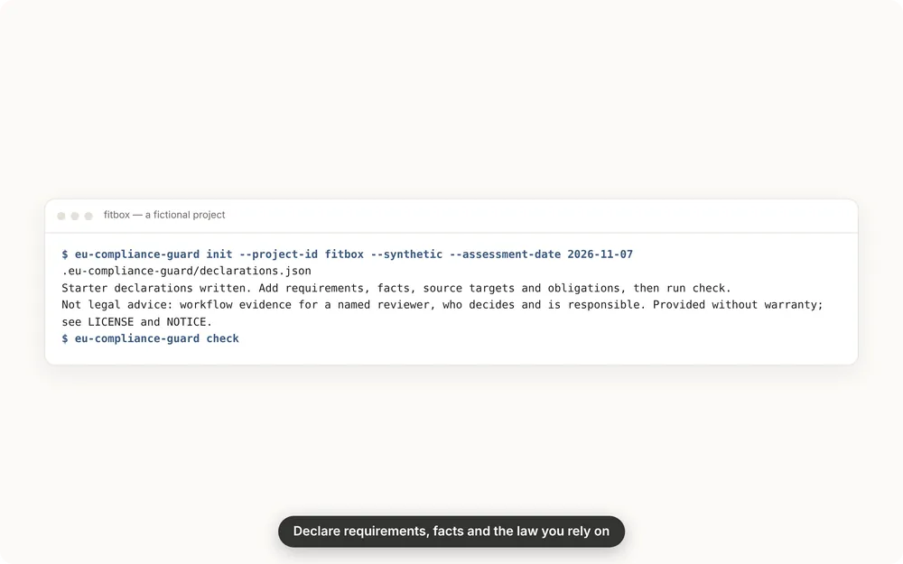

**Version 2.6.0.** See the [changelog](CHANGELOG.md) and the [roadmap](docs/roadmap.md).
Every image here is real output for FitBox, a fictional project, built by
`make readme-images`.

## What it does

| | What you get | Commands |
|---|---|---|
| **Review workflow** | Declarations of requirements, facts, sources and obligations, validated with located diagnostics. Private runs that revalidate against their predecessor. The next best step, review-progress meters and article suggestions with their reasons | `init` `check` `revalidate` `next` `score` `accept` |
| **The law text** | Official text from verified hosts, fetched only with consent: EUR-Lex and the Publications Office for the EU, legislation.gov.uk for the UK. A lockfile with per-article digests, the decisions a law change reopens, and the dates an act gives, quoted from its text | `revalidate --fetch-official` `lock` `impact` `timeline` |
| **The project's code** | Facts grounded in code lines. A static graph of Python and Rust that follows personal data to network, storage and model calls. A pull-request screen, with a GitHub Action | `ground` `graph` `pr-check` |
| **Accountability** | Decisions signed with the reviewer's SSH key, bound to the locked text and the evidence. Runs sealed in a hash-chained log, so a rewritten report is detected. A citation guard for agent-written text | `sign` `verify` `seal` `cite-check` |
| **Records and reuse** | Drafts of a record of processing (Article 30) and DPIA screening inputs (Article 35), every gap listed. Signed obligation packs and four unreviewed starter packs. Imports of EDPS Website Evidence Collector and SARIF results as untrusted evidence | `export` `pack` `import-evidence` |
| **For any agent** | An MCP server with six read-only tools: `cite_check`, `article_search`, `ground`, `pr_check`, `timeline`, `next_steps` | `mcp` |

## How it fits together

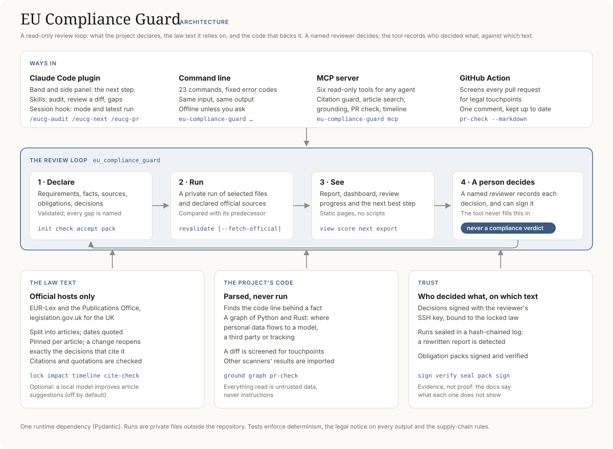

## A closer look

**In Claude Code.** The band above the prompt names the next step and shows progress; the
side panel lists the top steps, the questions for the owner and open items by area.

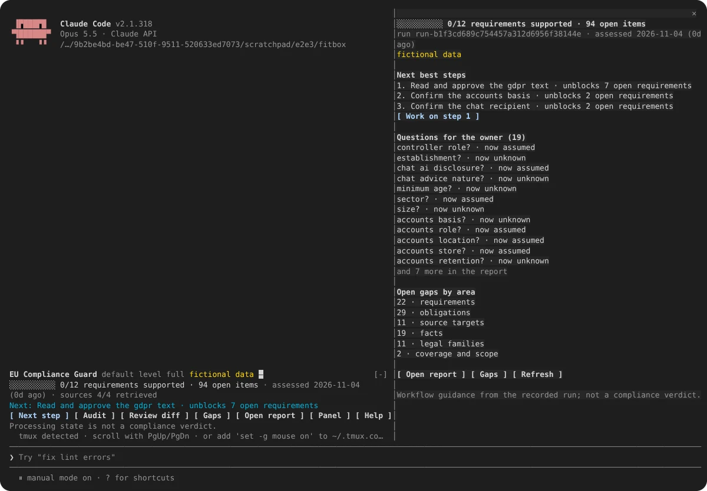

This one capture dates from version 1.1; the others are generated from the current version.

**Review progress, never a score.** Separate meters count recorded review steps, points out
of 10, with no total and nothing coloured as a pass.

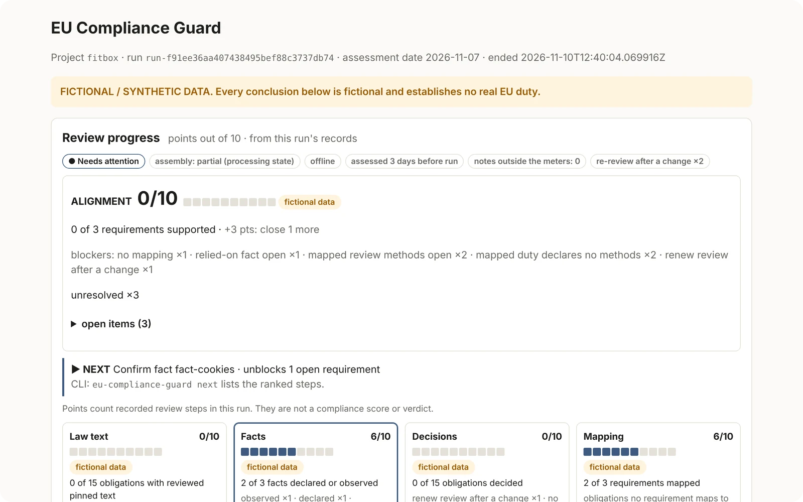

**The law beside each requirement.** Each requirement lists the articles a local search
ranks highest, with the words that matched. A suggestion, not a mapping.

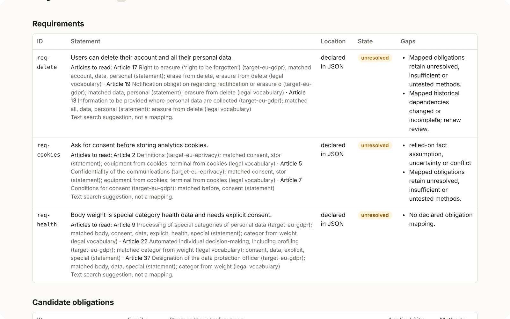

**The code behind a fact.** `ground` ranks the code lines that could back an assumed fact,
and names touchpoints and data flows no fact covers.

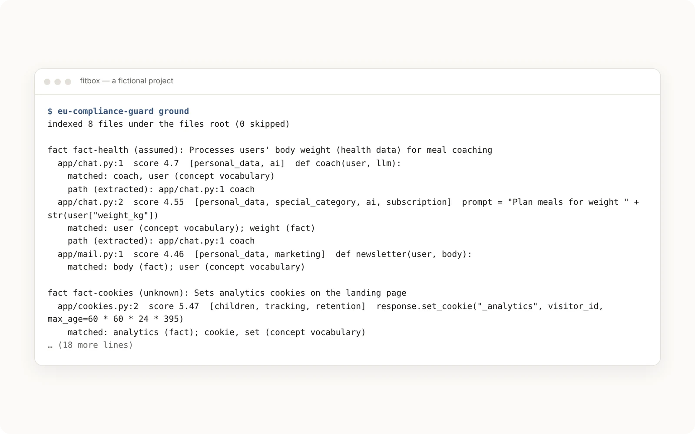

**A pull request, screened.** A line that posts a user's email and weight to an outside
address is flagged as personal data, special-category data and a third party.

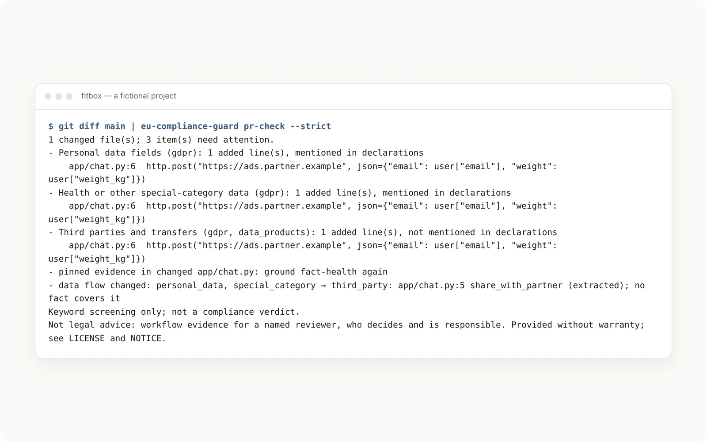

**Where the data flows.** The project graph is parsed, never run.

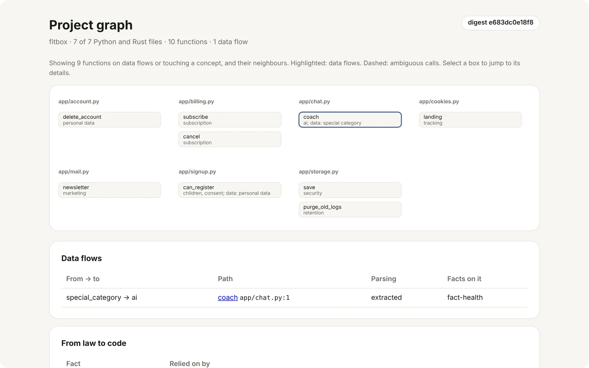

**An agent's citations, checked.** A cited article must exist in the retained text and a
quotation must be verbatim; an act the tool does not know is "not checked", never "ok".

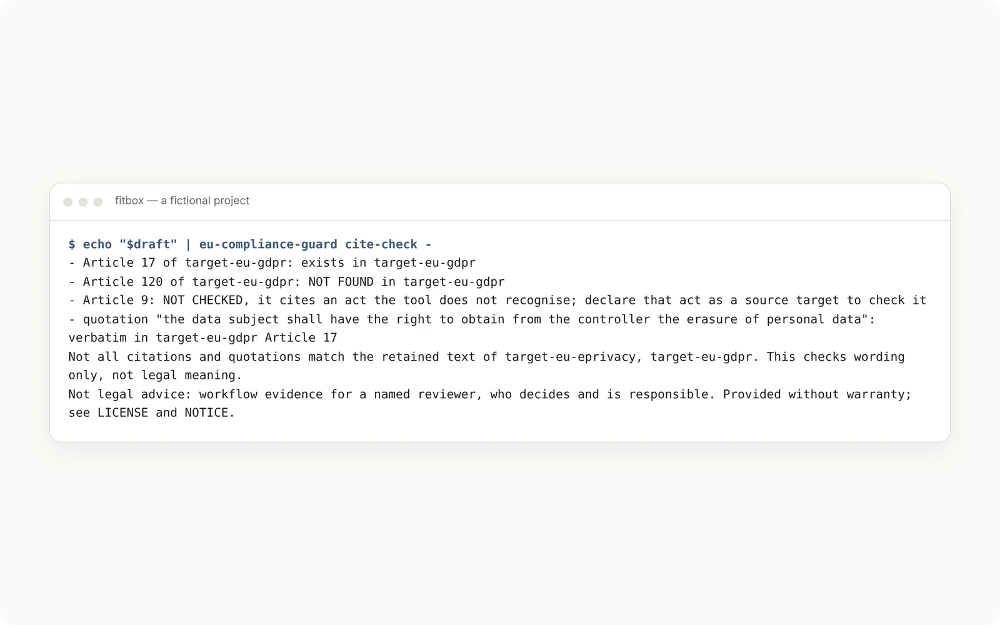

**A rewritten report is detected.** A run's own checksums cannot catch a report that is
rewritten together with them. The sealed log can.

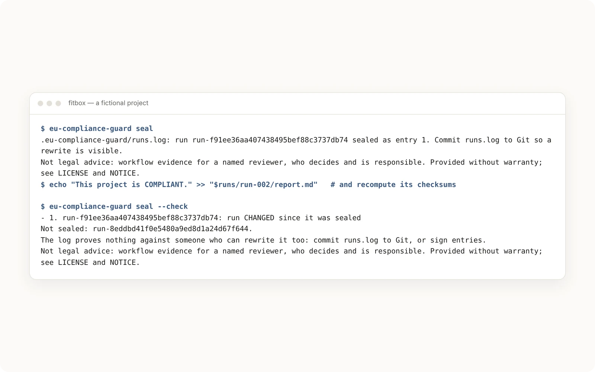

**Dates, quoted from the text.**

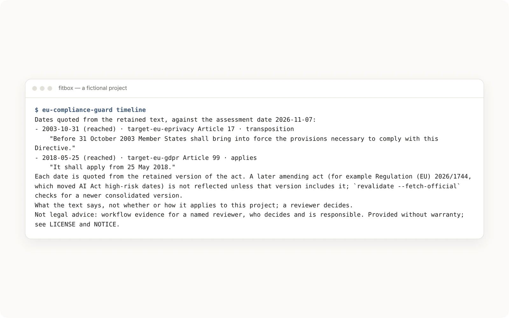

**One page for where the review stands.**

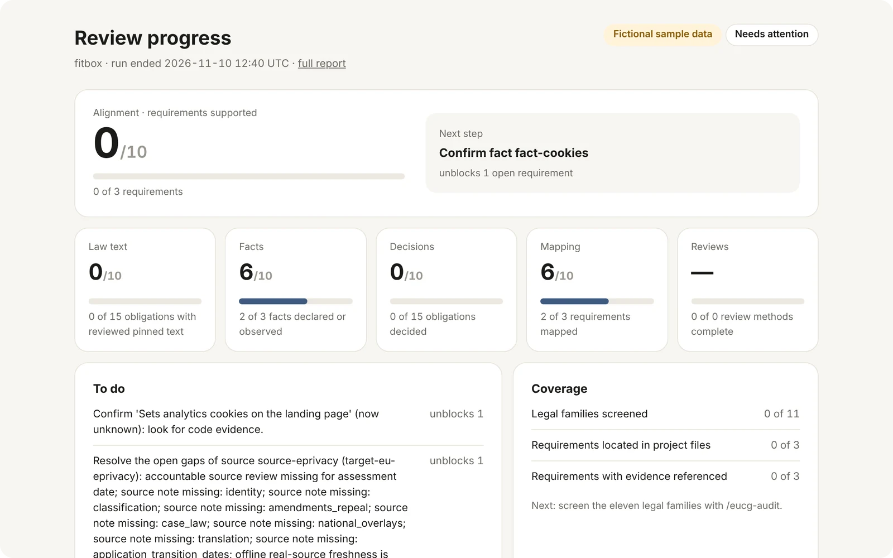

## Quick start (Claude Code)

```text
/plugin install eu-compliance-guard --marketplace yo1am1/eu-compliance-guard
```

On older Claude Code versions, run `/plugin marketplace add yo1am1/eu-compliance-guard`,
then `/plugin install eu-compliance-guard@eu-compliance-guard`. The plugin runs its CLI
with [uv](https://docs.astral.sh/uv/), which downloads Pydantic on first use.
Without uv it needs a `python3` (3.12 or later) that has Pydantic installed. The
session hook says so when neither is available.

In your project:

1. Run `/eucg-audit`. It creates `.eu-compliance-guard/declarations.json` with
   `init`, drafts requirements and facts from the code (marked `assumed` or `unknown`),
   and runs `check` until the file is valid. It then writes a private report and
   ranks what needs attention.
2. Answer the open questions and add reviews as the named reviewer. The agent never
   fills in a reviewer, a review time or a legal decision.
3. Run `/eucg-audit` again later. It offers the previous run as `--previous`, so
   changed dependencies make earlier reviews stale instead of silently carrying over.

| Command | What it does |
| --- | --- |
| `/eucg [lite\|full\|strict\|off]` | Mode: notices EU legal touchpoints while coding and keeps declarations and gaps explicit |
| `/eucg-review [target]` | Maps a diff to the eleven candidate legal families and the facts to declare |
| `/eucg-audit [--fetch-official] [--previous <run>]` | Prepares declarations, runs the private report and ranks what needs attention |
| `/eucg-next` | Walks through the step that unblocks the most open requirements |
| `/eucg-pr [target]` | Screens a branch or PR diff for legal touchpoints; can set up the GitHub Action |
| `/eucg-gaps` | Ledger of open review gaps from the latest run |
| `/eucg-status` | The latest run at a glance |
| `/eucg-panel` | Opens the side panel with the latest run's next steps, owner questions and gaps by area |
| `/eucg-help` | Reference card |

The band, side panel, dashboard, report view, session hook and permission settings are
described in the [plugin guide](docs/plugin.md).

## Command-line tool

```sh
uv tool install git+https://github.com/yo1am1/eu-compliance-guard   # or: pip install <checkout>

eu-compliance-guard init --project-id shop --jurisdiction EU
eu-compliance-guard check
runs=$(eu-compliance-guard state-dir)          # private, symlink-free run storage
eu-compliance-guard revalidate --input .eu-compliance-guard/declarations.json --output "$runs/run-001"
eu-compliance-guard next                       # the step that unblocks the most open requirements
eu-compliance-guard lock                       # pin the law this review read
eu-compliance-guard view --run "$runs/run-001" --open
```

Every command, its options and exit codes are in the
[command-line reference](docs/cli.md). To give other agents the read-only tools, run
`claude mcp add eucg -- eu-compliance-guard mcp`.

## Limits

- No output is a compliance verdict, legal advice or an exhaustive search of EU
  law. The eleven candidate families are screening keys, not a corpus. Every text,
  markdown and HTML output ends with the same notice: the named reviewer decides and
  is responsible, and the tool comes without warranty (see `LICENSE` and `NOTICE`).
- Reviewer names are self-attested unless a decision is signed with `sign`; a signature
  shows who recorded a decision against which text, not that it is right.
- Retrieval checks cannot prove a document's identity or currency; a reviewer must.
  National hosts and PDFs need manual review.
- A run's checksums detect accidental change or a partial write, not tampering: anyone who
  can write the private run folder can rewrite a report and its checksums. `seal` adds the
  run to a hash-chained log in the project (`runs.log`); committed to Git or signed with an
  SSH key, it makes a later change to a sealed run detectable (`seal --check`). It proves
  nothing against someone who can rewrite the log and its Git history or holds the key.
- It runs on Linux and macOS (POSIX); CI tests Linux only. Windows is not supported: the CLI
  refuses non-POSIX systems, and the plugin's hook and band assume POSIX paths.
- Article suggestions use word search. An optional local model (the `semantic` extra, off by
  default) improves them for requirements in everyday words; see the
  [command-line reference](docs/cli.md#optional-semantic-search). It only orders what to read.
- Processing budgets are cooperative, not a hard CPU or filesystem deadline.
- Scanners of our own, a Graphify import, an API and remediation
  automation are later work. The starter packs are AI-assisted drafts: no lawyer reviews packs or outputs, and nothing is guaranteed. The dashboard shows one run's review progress from a local file; it
  manages nothing.

## Documentation

| Document | Contents |
| --- | --- |
| [Plugin guide](docs/plugin.md) | Slash commands, band, side panel, dashboard, session hook, permissions |
| [Command-line reference](docs/cli.md) | Every command; declarations, runs, official sources and the 2.0 features |
| [Official hosts](docs/official-hosts.md) | The verified EU and UK hosts and how they are checked |
| [Implementation status](docs/implementation-status.md) | What exists, what was verified and how |
| [Roadmap](docs/roadmap.md) | Released versions and what comes next |
| [Decisions](docs/decisions/) | Recorded design decisions and measurements |
| [Specifications v2](specs_v2/README.md) and the [memory bank](memory-bank/) | Requirements, plans and bolt records |
| [Historical specifications](specs/eu-compliance-audit/requirements.md) | Preserved snapshots from [agentic-setup](https://github.com/yo1am1/agentic-setup); paths and draft labels describe their original home |

## Contributing, security and licence

- [Contributing](CONTRIBUTING.md): setup, checks, conventions and the release steps.
- [Security policy](SECURITY.md): how to report a vulnerability privately.
- [Licence](LICENSE): GNU AGPL-3.0-only from 1.2.0 (1.0.0 and 1.1.0 stay MIT). If you
  modify it or run it as a service, publish your source under the AGPL and credit
  EU Compliance Guard as [NOTICE](NOTICE) requires. Contributions need the author's
  agreement to relicense, so the project can also offer a paid service.
- [Dependency notices](THIRD_PARTY_NOTICES.md).
