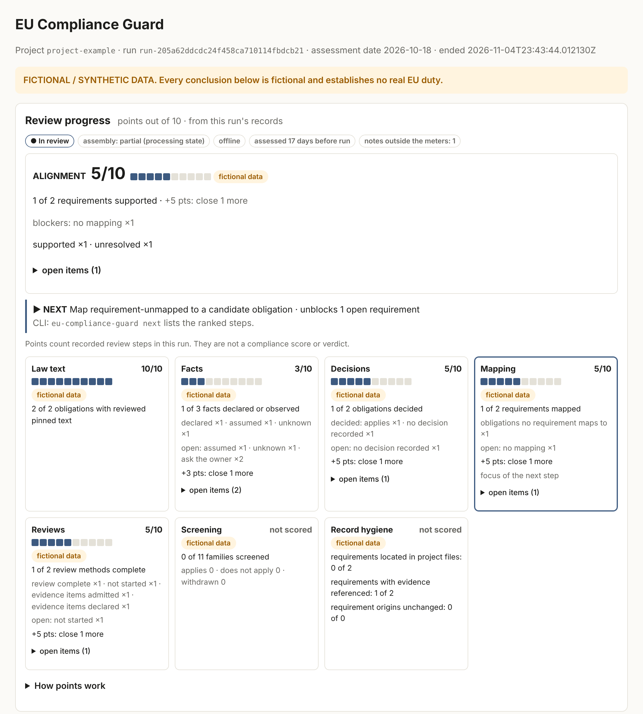
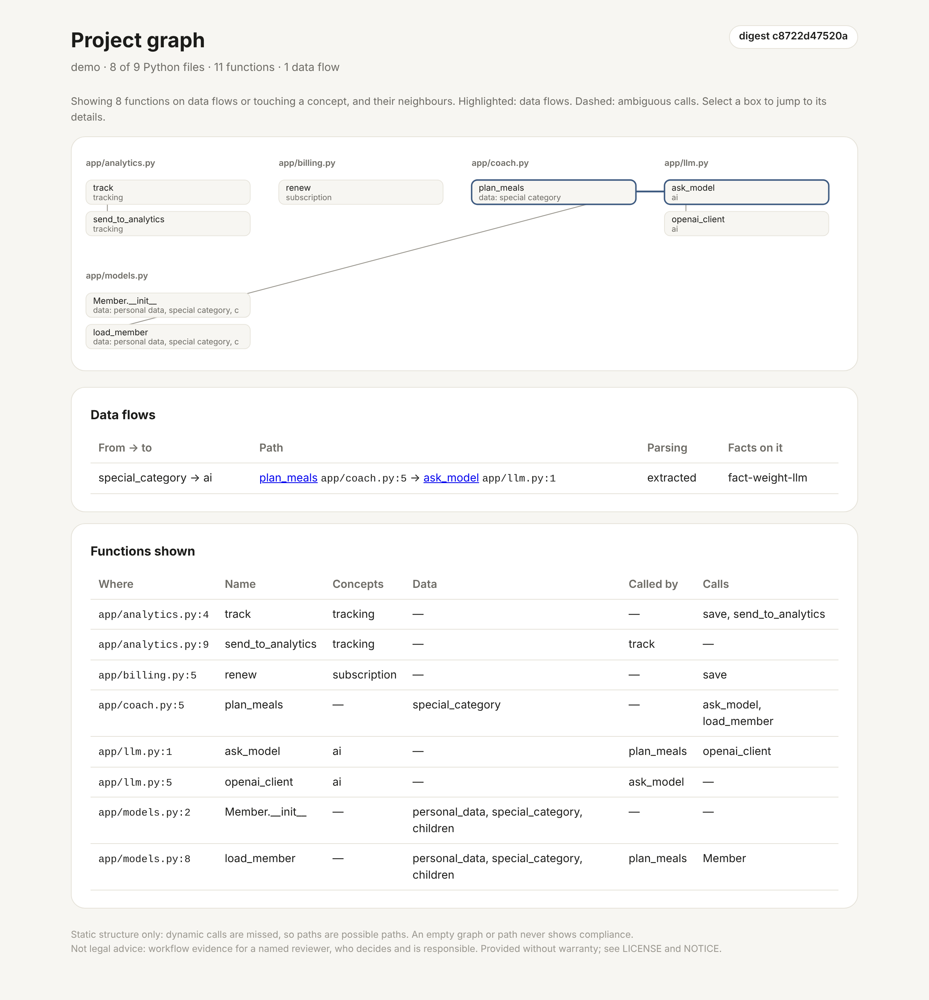

# Command-line reference

Every command is read-only toward legal conclusions: none of them decides whether an obligation applies or whether a project complies.

## Install and overview

Install with `uv tool install <path-to-checkout>` or `pip install <path-to-checkout>`. This
provides the `eu-compliance-guard` command (also `python -m eu_compliance_guard`).

| Command | Purpose |
| --- | --- |
| `init --project-id <id> [--path <file>] [--assessment-date <date>] [--jurisdiction <j>]… [--synthetic]` | Write a valid starter declarations file; never overwrites |
| `check [--input <file>] [--previous <run dir>] [--json]` | Validate declarations: each problem with its JSON location, the observed digest of every selected file, whether each source target can be fetched, whether an offline run fits the output limits, and (with `--previous`) every record that needs a higher revision |
| `revalidate --input <file> --output <new run dir> [--offline \| --fetch-official] [--previous <run dir>]` | Assemble and publish a private run |
| `ground [--input <file>] [--top N] [--json] [--apply <fact>=<path>:<line>]…` | Rank code evidence for each assumed or unknown fact, and each fact whose pinned evidence changed, with a local index. `--apply` marks a confirmed technical fact `observed`, pinned to that file's digest |
| `state-dir [--input <file>]` | Print and create (0700) the private run storage for the declared `project_id` |
| `next [--run <run dir>] [--top N] [--json]` | Rank the open steps of the newest (or given) run by how many open requirements each unblocks |
| `score [--run <run dir>] [--against <run dir>] [--top N] [--json]` | Show the review progress of the newest (or given) run: separate meters, points out of 10, never a compliance score. Exit 0 whatever the points |
| `pr-check [--diff <file>\|-] [--input <file>] [--markdown\|--json] [--strict]` | Screen a diff's added lines for legal touchpoints, undeclared concepts and pinned evidence in changed files; `--strict` exits 1 when something needs attention |
| `view --run <run dir> [--dashboard] [--open]` | Verify a run and write `<parent>/views/<run>.html`, `<run>.dashboard.html` and `<run>.scorecard.json` (all 0600); print and optionally open the report, or with `--dashboard` the dashboard |
| `lock [--input <file>] [--run <run dir>] [--output <file>]` | Record each act's version and article digests from a run in `eu-law.lock` |
| `impact [--input <file>] [--run <run dir>] [--lock <file>] [--json] [--strict]` | List the articles changed since the lock and the obligations, decisions and requirements citing them |
| `sign --decision <id> --key <ssh key> --principal <name> [--lock <file>]` | Sign a reviewed applicability decision against the locked law and its evidence |
| `verify --allowed-signers <file> [--json]` | Check each signed decision: valid and current, changed since signing, or invalid |
| `cite-check <file\|-> [--run <run dir>] [--json]` | Check cited articles and verbatim quotations against the retained official text |
| `pack build\|sign\|verify\|import …` | Draft, SSH-sign, verify and import reusable obligation packs (candidate obligations only) |
| `import-evidence --kind wec\|sarif <file> [--json]` | Keep an EDPS Website Evidence Collector or SARIF result as untrusted evidence, summarised by concept |
| `accept <requirement>=<target>:<article>` | Map a requirement to a candidate obligation citing an article; no decision |
| `graph [--input <file>] [--json] [--view [--open]]` | Map the project's Python files, functions, imports, calls and data flows (static) |
| `mcp [--input <file>]` | Serve `cite_check`, `article_search`, `ground`, `pr_check` and `next_steps` as read-only MCP tools over stdio |

```sh
eu-compliance-guard init --project-id shop --jurisdiction EU --jurisdiction DE
eu-compliance-guard check
runs=$(eu-compliance-guard state-dir)   # private, symlink-free run storage
eu-compliance-guard revalidate --input .eu-compliance-guard/declarations.json \
  --output "$runs/run-001" --offline
eu-compliance-guard revalidate --input .eu-compliance-guard/declarations.json \
  --previous "$runs/run-001" --output "$runs/run-002" --offline
eu-compliance-guard view --run "$runs/run-002" --open
```

Exit codes: 0 means the artifacts were published, even when the report is partial
(`check`: the declarations are valid). 2 means invalid input or an unusable path;
diagnostics are fixed codes such as `invalid-input` or `output-exists`, never input
values. Output that cannot be written (a closed pipe or a full disk) is
`io-failed: output failed` with exit 2, even when the command's work, such as a published
run or rewritten declarations, is already done. Characters the console cannot encode are
printed as backslash escapes. 130 means the run was interrupted.

## Declarations

`.eu-compliance-guard/declarations.json` is a versioned `RevalidationInput` record.
Its schema is `$defs.RevalidationInput` in
[`eu_compliance_guard/contract.schema.json`](../eu_compliance_guard/contract.schema.json).
A complete fictional example is [`fixtures/revalidation-synthetic.json`](../fixtures/revalidation-synthetic.json).
It holds the scope and facts, requirements, source targets, selected sources,
candidate obligations, applicability decisions, evidence references and reviews.

File paths resolve relative to the declarations file, or to the project folder (its
parent) when `"files_root": "project"`, which `init` sets for the default `.eu-compliance-guard/` folder (elsewhere it sets `"declarations_dir"`). Only explicitly selected
regular files are read; nothing is discovered, crawled or executed. Facts keep their
basis (`declared`, `observed`, `assumed`, `unknown`). Changing a versioned record
requires a higher `revision`; `check` names the exact location of every stale pin, and
with `--previous` every record that needs a higher revision, including those whose pins
must follow a raised revision.

## Run directories

The output parent must exist, belong to you and exclude group/other permissions, and
the run directory must be new. No component of an input, output or predecessor path may
be a symbolic link (`unsafe-path`, as for a missing output parent or an overlong name;
missing declarations, file or folder, are `io-failed` in every command); `state-dir` prints a resolved path, and on macOS
`$TMPDIR` lives under the `/var` symlink, so use `state-dir` or `pwd -P` paths. Runs use modes 0700/0600 and are never overwritten.
Each run holds:

- `input.json` (normalized declarations), `manifest.json`, `bundle.json` and `report.md`;
- the retained source bytes under `sources/`, and `comparison.json` when `--previous` was given;
- `complete.json`, which lists the exact digest of every artifact.

Evidence bodies are never copied or rendered. A directory without a valid completion
marker is incomplete; retry under a new path. A run path that names no directory, or a
run file that cannot be opened safely (permissions, a symbolic link), is `unsafe-path`
instead: correct the path or the permissions, because the run itself may be intact.

The report starts with what needs attention. Each reviewed deficiency or open
question sits beside its project requirement and location, declared legal
identifier and article, evidence reasoning and next review action. Missing
applicability or legal support stays a review gap, never an established violation.
An obligation reviewed as not applicable is not a violation either: its methods are
recorded as not assessed, which keeps the run partial, and a requirement mapped to it
stays unresolved.

## Official sources

The network is off by default. `--fetch-official` sends bounded GETs to the declared
source targets, and only to six exact hosts: `eur-lex.europa.eu`, `curia.europa.eu`,
`commission.europa.eu`, `digital-strategy.ec.europa.eu`, `www.edpb.europa.eu` and
`publications.europa.eu` (the Publications Office's machine endpoint, Cellar). For
Cellar alone, its own same-host `http://` redirect is upgraded to https; every other
downgrade is refused. Requests carry the target's language as `Accept-Language`.
[docs/official-hosts.md](official-hosts.md) names each host's operator and purpose
and the last reachability check; `make verify-hosts` repeats that check with consent.
A base CELEX (`resource/celex/32002L0058`) returns the act as first published; for the
law in force use a consolidated CELEX such as `02002L0058-20091219`, and have a reviewer
confirm that it is the latest consolidation. `check` warns when an `eu_act` target uses a
base CELEX and lists each target's version ("consolidated 2009-12-19" or "as first
published"). Each article excerpt in the report names the version it comes from. With
`--fetch-official`, the same consent also asks the Publications Office's official SPARQL
endpoint, once per act target with a CELEX number, whether a newer consolidation exists.
The query is built only from the CELEX number. A newer version, or an answer that could
not be read, becomes a review gap on the run; the declarations are never changed.

- Requests use HTTPS on port 443 only, with no credentials and no proxy.
- DNS answers must all be public, and the connection is pinned to a validated
  address. TLS is verified.
- At most three validated redirects are followed. Limits are 8 MiB per response,
  20 s per target and 300 s per run.
- Fictional fixture targets are never contacted.

Each target gets a recorded attempt. Accepted bytes are retained as unreviewed
candidates, and login, challenge and error pages are rejected. Hosting alone
establishes neither binding status, completeness, applicability nor currency.

EUR-Lex answers scripted clients with a bot challenge, which is recorded as a safe
failure. Download the act yourself (PDF or HTML) and declare it as a selected
source; `/eucg-audit` walks through this, and `check` reports the digest to use. In
1.0, only text and HTML sources can support a mapping. A PDF can be declared and
reviewed, but it always remains a "needs manual identity review" gap, so also save
the HTML version of an act you want to rely on. Some official pages, such as EDPB's, change bytes on every request, so
exact-byte comparison reports them as changed. See the
[live smoke check](../memory-bank/bolts/002-legal-revalidation-cli/live-smoke-report.md).

## Revalidation

`--previous` takes one explicitly selected run. Its completion marker, every listed
digest, declarations, manifest and required source bytes are verified first. A
corrupt, incomplete, cross-project or symlinked predecessor fails with exit 2. The
successor stores `comparison.json` and freshness overlays, and links the parent
without changing any predecessor file.

Relevant changes make historical reviews stale and withdraw affected support.
Withdrawn support stays withdrawn in later runs. It is restored only when the
obligation's applicability decision and every evidence review for it are new
revisions with a `reviewed_at` after the predecessor run and no later than the
current run. Withdrawn family screenings follow the same rule. Renewals are not counted
as new changes. A renewal recorded in the same run as another relevant change does not
count, because the review cannot be shown to follow that change: the run withdraws
support and says so, and the reviews must be renewed again after that run.
`check --previous` warns about withdrawn obligations and family screenings that the
declarations do not renew yet. A family screening that the declarations set back to
`unresolved` claims no support, so nothing is withdrawn from it; declaring an
applicability again is a changed record that needs a fresh `reviewed_at`. Any other new or changed review record, including one moved to a
renamed or re-added obligation, cannot carry support. An attestation dated after the
run that reads it is always a review gap.

Each run compares against the one predecessor you name. Naming an older run, or none,
compares against that state, so always use the newest completed run (`/eucg-audit`
offers it) unless you deliberately want another baseline. Offline and `--fetch-official` runs of the same tool version count as
the same configuration.
Missing evidence or an offline or failed refresh makes freshness unknown. Withdrawal
follows the reviews the predecessor declared, so a file it could not read does not
shield them from a later change; reading exactly the declared bytes again is no change. Matching
bytes establish only matching recorded inputs, never current law or renewed
approval. Incomplete dependency attribution and any known change to family
screenings withdraw support conservatively.

## Review progress

`score` (and the top of the HTML view, the band and the panel) shows how far the
recorded review of one run has come. Each meter gives points out of 10 for one stage
of the review chain. There is no total, sum or average, and no meter is a compliance
score or verdict: they count recorded review steps of that run only. The decision is
recorded in [`docs/decisions/dashboard-review-progress.md`](decisions/dashboard-review-progress.md).

Points for `done` of `total` items: "not scored" when nothing is declared, 0 only when
none are closed, 10 only when all are, otherwise `10 × done ÷ total` rounded down and
kept between 1 and 9. Each meter names how many more items raise it.

| Meter | Counts | Raise it by |
| --- | --- | --- |
| Alignment | requirements the run records as supported | closing each requirement's named blockers (mapping, facts, evidence, origin, decisions, reviews) |
| Law text | obligations whose every pin points at a listed locator of a selected source with no open source gap (duties need a binding source) | retrieving or downloading the official text, reviewing it as a source and pinning listed locators |
| Facts | distinct declared facts that are declared or observed, without conflicts or changed evidence | `ground`, `ground --apply`, or the owner confirming organisational facts |
| Decisions | obligations with an accepted `applicable` or `not_applicable` decision | recording accountable applicability decisions |
| Mapping | requirements with at least one `obligation_refs` entry | mapping each requirement to a candidate obligation |
| Reviews | non-technical review methods of obligations that may apply, recorded as complete | recording accountable evidence reviews |

Alignment also shows a ceiling when this run cannot reach 10 for a structural
reason: technical methods (this workflow never runs them) or real sources an offline
run cannot confirm (`revalidate --fetch-official`). Unmapped or methodless
requirements are blockers, not ceilings. The eleven legal families appear as a
coverage line ("k of 11 families screened"), and record hygiene (requirements located
in project files, requirements with evidence referenced, origins unchanged) as
unscored counts. The status is one of `declarations incomplete`, `needs attention`
(a reviewer recorded insufficient evidence, a change needs re-review, declared
evidence or a requirement origin changed), `in review` or `recorded steps closed`;
none of them is a verdict. `--against` adds point changes only when that run is the
recorded parent and used the same tool version; the trend never changes the status.



`view` also writes `<parent>/views/<run>.scorecard.json` (0600) as data for other
tools. The plugin never needs it: its **Dashboard** button opens the static page above.
For a future hosted service, `frontend/` holds a React page that renders such a file
(`npm --prefix frontend run build`, then `npm --prefix frontend run preview`; choose
or drop the file). It is read in the browser only; the page's Content Security Policy blocks every
connection, and its types are generated from `eu_compliance_guard/models.py`.

## Accepting a suggestion

`accept REQ=TARGET:ARTICLE` (for example `accept req-delete=target-gdpr:Article 17`)
turns an article suggestion into a mapping in one step. The requirement gains a
candidate obligation that pins the article. An obligation that already pins the same
target and article is reused; otherwise one is created, as a duty when the target is
binding law and a recommendation otherwise, with no invented review methods. Revisions
rise and every pin follows. The file is validated and written atomically, never
through a link, and running it again changes nothing. No applicability decision is
recorded: the obligation stays unresolved until a named reviewer decides.
`/eucg-next` offers this for mapping steps.

## Grounding assumptions in the code

`ground` builds a local index of the project's text files: no network, model or
embeddings, a bounded number of files, and no symlinks or dependency folders. It uses
Okapi BM25 over identifier-split tokens, and a lexicon of legal concepts expands each
query (tracking, special-category data, children, AI, subscriptions, retention and
more). For every assumed or unknown fact, and every fact whose pinned evidence changed
or is missing, it lists ranked `file:line` candidates, and it also lists touchpoints
that no fact covers. Organisational facts are flagged, because code can never show
them. `--apply` accepts a line only if it shares terms with the fact. It then records
the fact as `observed` with the file as evidence, which closes that fact's gap until
the file changes; `ground` then lists it again to be pinned anew. Pinning it anew, in
the same or another file, drops its code evidence for a changed or deleted file.
Repeated `--apply` values are all checked first: if one is refused, none is written.

## Project graph

`graph` maps the Python files under the files root: files, classes and functions, the
imports between files, and the calls between functions. It also lists the concepts
each function touches (personal data, tracking, AI and others), using the same rule as
the pull-request check. It only parses code (`ast`). Nothing is imported or run, links
and dependency folders are skipped, and a file that does not parse is counted as
skipped.

Calls resolve the way Python looks names up: the same file first, then imported names
and modules. A name that only matches several definitions elsewhere is labelled
`ambiguous`, never guessed. The same files always give a byte-identical graph
(`--json`) with one digest. Static parsing misses dynamic calls, so paths through the
graph are possible paths, and an empty graph never shows compliance.

`ground` uses the graph to follow data. A flow is the shortest call path from a
function that handles personal, health or children's data to the first function that
reaches an AI model, tracking, a third party or marketing. Each hop carries its
`file:line`, and a flow through an ambiguous call is labelled `ambiguous`. A candidate
inside a flow shows that path. A flow with no pinned evidence on any of its functions
is listed under "data flows no fact covers", and pinning a line on it with `--apply`
accounts for it.

`graph --view [--open]` writes `<state-dir>/views/graph.html`, and the panel's **Graph**
button opens it. Like the dashboard, it is one static file with no script and no
request, kept private (0600). It draws the functions on data flows or touching a concept,
and their neighbours, in a fixed layout: one column per file. Flows are highlighted and
ambiguous calls are dashed, and each box links to its details. Tables list each flow
with the facts pinned on it, and each fact with the requirements and obligations
(and their articles) that rely on it. How many functions were left out is always stated.



## Pull-request check

`pr-check` reads a unified diff (a file or standard input) and the declarations: the
`--input` file, which must then exist (`io-failed` if it does not), or `.eu-compliance-guard/declarations.json` if
present. A declarations folder it cannot read is an `unsafe-path` error, never an
absent file. It lists the legal concepts in added lines with their candidate families, says
whether the declarations already mention each concept, and flags code evidence or
requirements that live in a changed file. It is deterministic and offline. Colour codes
from `git diff --color` are ignored; input that names no changed file (prose or a
`--stat` summary) or holds hunk lines a unified diff cannot (such as `--word-diff`
output) exits 2 with `invalid-input` instead of passing unread. A merge's combined diff
(`git show <merge>`) is screened too: a line added against any parent counts. With
declarations, it also maps the checked-out Python code (as `graph` does) and lists each
data flow whose functions gained an added line, with the facts pinned on that flow, or
says that no fact covers it. Each counts as an item needing attention. In a monorepo,
run it from the repository top with `--input <project>/.eu-compliance-guard/declarations.json`;
diff paths are matched below that project's folder. To run it on
every pull request, copy [`examples/github/eu-compliance-guard-pr.yml`](../examples/github/eu-compliance-guard-pr.yml)
into `.github/workflows/`; it keeps one comment updated, and `--strict` can fail the
check. It is keyword screening: a diff with no touchpoints is not a clean bill.

```bash
git diff origin/main...HEAD | eu-compliance-guard pr-check --markdown
```

## Search evaluation

`make eval` scores article search and code grounding on a fixed synthetic set in
`fixtures/eval/`. The set is a fictional 28-article act written for this purpose (not
law), 40 developer-style requirements split into a tuning half and a held-out half, and
a small fictional code project with 10 facts. It reports top-1 and top-3 hits. A test
keeps the scores at or above `fixtures/eval/baseline.json`, and a search change ships
with its before/after numbers. The numbers measure ranking, not legal correctness.

## Law lockfile and change impact

`lock` records the law a run's reviews read. For each act whose text the run retained, it
stores the version (CELEX), the source digest and a digest per article, in
`.eu-compliance-guard/eu-law.lock`. The lockfile is deterministic and meant to be
committed with the declarations. After a newer run, for example one with
`--fetch-official` once the consolidated text has moved, `impact` compares that run with
the lock. It lists the changed, added and removed articles, then the obligations citing
them and their applicability decisions and mapped requirements: exactly those need
review again. An act whose text the newer run did not retain is reported as not compared,
never as removed, and a lock from another project is refused. Nothing is reopened or
decided automatically. `--strict` exits 1 when a
declared obligation cites a changed article, so CI can flag it.

## Signed decisions

`sign --decision ID --key ~/.ssh/id_ed25519 --principal you@example.org` signs one
applicability decision with your own SSH key (`ssh-keygen -Y sign`, the format Git uses).
A named reviewer must have recorded the decision first. The signed record holds the
decision, its obligation, the locked digest of each article it cites, the digests of the
evidence it relies on, and the project's commit. It is stored in
`.eu-compliance-guard/signatures/<decision>.json`. `verify --allowed-signers FILE` checks
each signature, then compares the signed record with the current files. It reports the
signature as valid and current, valid but out of date (naming what changed since: the
decision, the obligation, the law or the evidence), or invalid. A signature file must
hold the decision it is named after, and a reviewed decision with no signature is listed
as not signed (which does not fail the command). A signature shows who
recorded a decision against which text. It does not make the decision right.

## Citation guard and MCP tools

`cite-check FILE` (or `-` for standard input) checks text an agent wrote against the
retained official text of the latest run. Every "Article N" it cites must exist in a
retained act. Every quotation of three words or more must appear in the article cited just
before it, word for word, ignoring case, whitespace and the style of quotation marks. It
exits 1 when a citation or quotation does not match. It checks wording only, never legal
meaning.

`mcp` serves the same check, plus `article_search`, `ground`, `pr_check` (given a diff)
and `next_steps`, as read-only tools over stdio for other agents. `ground` only proposes
lines; pinning one stays a person's step with `ground --apply`. For example
`claude mcp add eucg -- eu-compliance-guard mcp --input .eu-compliance-guard/declarations.json`.

## Obligation packs

A pack is one versioned JSON file of reviewed obligations: their conditions, exceptions
and exact article pins, the source targets those pins name, and the digest of each
article the reviewer read (taken from `eu-law.lock`). Pins name a target and an article,
never one project's source copy, controls or overlays, so a pack moves between projects.

- `pack build --id ID --title TITLE --output FILE [--obligation ID ...] [--status reviewed]`
  drafts a pack from this project's obligations.
- `pack sign FILE --key KEY --principal NAME` signs the file with the reviewer's SSH key
  and writes `FILE.sig` beside it.
- `pack verify FILE --allowed-signers SIGNERS` checks that signature.
- `pack import FILE --allowed-signers SIGNERS` (or `--unsigned`, on request) adds the
  pack's targets and obligations to the declarations. A record that already exists with
  different content is never overwritten. When the project's lock has different text for
  an article the pack was reviewed against, import names it.

Import never maps a requirement and never decides applicability: map with `accept`, then
a named reviewer records each decision. 2.0 ships the format only; no
pack content is included yet.

## Importing other tools' results

`import-evidence --kind wec FILE` reads an EDPS Website Evidence Collector
`inspection.json`, and `--kind sarif FILE` reads a SARIF 2.1 log from any scanner. Both
are kept as untrusted evidence: a copy and a summary named by the file's digest, under
`.eu-compliance-guard/imports/`. The summary groups the findings by the concepts the
review uses: cookies, storage and beacons under tracking, third-party hosts under third
parties, missing HTTPS and forms sent without TLS under security. SARIF results are
classified by their rule, message and tags, and results that match no concept are kept as
unclassified. Tool text is shown as short, single lines with control characters removed,
and it is never followed. The declarations are never changed: a reviewer reads the
summary and declares the copy as evidence by hand. An empty import shows only that the
tool reported nothing.
