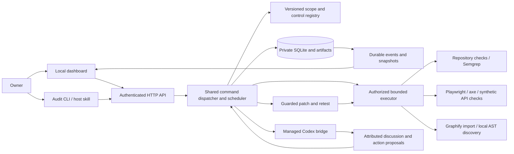

# EU compliance audit — design

Status: **design draft for user review; implementation and task planning not yet approved**.  
Date: 2026-10-14.  
Internal review: **approved by all four Dreamteam reviewers after corrections**; [adjudication and checks](reviews/design-adjudication.md).  
Basis: [approved requirements](requirements.md), [source research](research.md), and four preserved Dreamteam reviews: [legal controls](reviews/legal-controls.md), [engine and scanners](reviews/engine-scanners.md), [frontend](reviews/frontend-experience.md), [CLI and release](reviews/cli-release-review.md).

## 1. Overview and decisions

Build one local Python audit application with a shared engine, a FastAPI HTTP interface, a command-line client and a React/TypeScript dashboard. SQLite and a private artifact directory retain scope, source versions, check attempts, findings, conversations, patch history and progress events. Repository scanners and Graphify locate candidate issues and related code; reproducible assertions and reviewed organizational evidence establish their bounded outcomes. Portable instructions remain in the existing canonical .agents library, while the executable application occupies a new isolated package. The first acceptance milestone demonstrates the full scan–inspect–discuss–fix–retest loop on a synthetic project before expanding control and host coverage.

| Decision | Chosen approach and reason |
| --- | --- |
| Runtime | Python >=3.12; isolated application dependencies, FastAPI/Pydantic and Uvicorn. Standard library for SQLite, JSON, hashing, CLI parsing and process supervision. Pin compatible releases during implementation. |
| Frontend | React, React DOM and TypeScript, built with Vite; plain CSS and system fonts. Related selection, chat, diff and event state justify components. No general routing, state/query library or component suite initially. |
| Deployment | One local engine process, one scheduler, one authoritative writer; built frontend served from that process. Linux/POSIX is the first supported execution platform. No hosted account, cloud service, queue or graph database. |
| Transport | Same-origin HTTP commands/queries plus native FastAPI SSE for progress. CLI attaches to the same authenticated local endpoint; no second socket protocol initially. |
| Browser checks | Playwright Python, a pinned browser and a local pinned axe-core bundle. Keep expected/actual assertions separately from traces. No custom browser recorder or permanent Node service. |
| Source scanning | Pinned Semgrep Community Edition with a small reviewed local rule set. Import its JSON and SARIF 2.1.0; matches remain leads until validated. |
| Graph | Optional Graphify JSON import and bounded relationship drill-down. Preserve producer/schema versions and provenance; no upstream benchmark claim or runtime-flow inference. |
| Agent bridge | First candidate: a bounded Codex App Server stdio adapter using existing native authentication. Installed schema and actual containment must pass feasibility checks before enabling it; other dashboard bridges are added only when required. |
| Mutation | Engine applies reviewed one-file text changes only in a controlled exclusive-write target. General source repositories receive reviewable patch proposals unless equivalent write conditions are established. No automatic multi-file apply initially. |
| Distribution | Separate installable Python application package with bundled built assets and complete portable skill resources. Keep the library's validators and provenance conventions intact. |

These are proposed design choices, not claims that dependencies, sandboxes, scanners or host integrations have been installed or tested. FastAPI documents native SSE from version 0.135.0; select a reviewed compatible release rather than add another SSE library. [FastAPI SSE](https://fastapi.tiangolo.com/tutorial/server-sent-events/). Vite supports a built frontend served by a traditional backend. [Vite backend integration](https://vite.dev/guide/backend-integration). Detailed tradeoffs and primary-source registers remain in the four linked reviews.

Architectural principles:

- One dispatcher owns permissions, check execution, results and events for every interface.
- Applicability, technical verification, manual review and freshness are independent dimensions.
- Results become authoritative only with durable evidence and recorded input versions.
- Imported source, documents, tool output and agent text are untrusted data; they cannot grant permissions or close findings.

## 2. Architecture



The CLI may own the same engine in-process for a headless execution when no owner exists. It still uses the same dispatcher, validation, store and scheduler. Host skills invoke the audit CLI; they contain no independent legal catalog or check implementations. The managed dashboard agent is a separate capability from installing the skill in a user's existing CLI.

### Proposed repository placement

```text
.agents/skills/eu-compliance-guard/     portable instructions and text references
apps/eu-compliance-audit/
  pyproject.toml / uv.lock            isolated runtime and reproducible dependencies
  eu_compliance_guard/
    models.py / engine.py / store.py  shared contracts, dispatcher and persistence
    api.py / cli.py                   transport entrypoints
    legal.py / catalog/              source/control records and reviewed definitions
    checks/ / adapters/              bounded checks and external-result translation
    execution.py / remediation.py    permissions, child ownership and patch journal
    agent.py                         first managed Codex protocol adapter
  frontend/                          React/TypeScript source and build metadata
  tests/ / fixtures/                 synthetic unit, integration and browser cases
```

Final file granularity follows actual implementation responsibility; this is not a requirement to create empty modules. Built assets belong in the application distribution, not in copied skill instructions. Existing root manifests describe imported instruction exports; new application code gets its own distribution inventory and license notices instead of false upstream attribution. The existing commerce application and its frozen specs remain outside this project's ownership.

## 3. Domain models and interfaces

The following TypeScript-style definitions describe the shared contract. Python models validate transport and persisted records; frontend types derive from their schema. Do not maintain a second independently authored contract in every host adapter.

```typescript
type Id = string;                     // opaque identifier, never a filesystem path
type Digest = string;                 // algorithm-tagged content digest

type Applicability = "applicable" | "not_applicable" | "unresolved";
type Outcome = "passed" | "observed_failure" | "unresolved_review"
  | "blocked" | "not_tested" | "lead";
type Freshness = "current_for_recorded_inputs" | "stale" | "unknown";
type RunState = "planned" | "running" | "cancelling" | "completed"
  | "partial" | "cancelled" | "interrupted";
type PatchState = "proposed" | "running" | "applied-awaiting-verification"
  | "verified" | "failed" | "blocked";
type SourceType = "eu_act" | "national_act" | "judgment" | "final_guidance"
  | "draft_guidance" | "proposal" | "standard" | "engineering_practice"
  | "synthetic_fixture";

interface Scope {
  id: Id; revision: number; project_id: Id; assessment_date: string;
  environment: string; activities: ProcessingActivity[];
  establishment: string[]; markets: string[]; customer_types: string[];
  roles: Fact[]; size_and_sector: Fact[]; jurisdictions: string[];
  included_scenarios: string[]; exclusions: string[]; permission_id: Id;
}
interface Fact {
  id: Id; revision: number; key: string; value: unknown;
  basis: "observed" | "declared" | "assumed" | "unknown";
  evidence_ids: Id[]; owner: string; observed_at: string; conflicts: Id[];
}
interface ProcessingActivity {
  id: Id; purpose: string; subjects: string[]; data_categories: string[];
  roles: Fact[]; lawful_basis: Fact; recipients: Fact[]; locations: Fact[];
  stores: Fact[]; retention: Fact[]; evidence_owner: string;
}
interface LegalSource {
  id: Id; revision: number; type: SourceType; publisher: string;
  identifier?: string; url: string; language: string; jurisdiction: string;
  document_date?: string; retrieved_at: string; content_digest: Digest;
  provisions: string[]; related_source_ids: Id[]; synthetic: boolean;
}
interface SourceAttempt {
  id: Id; source_target_id: Id; intended_url: string; intended_identifier?: string;
  publisher: string; intended_type: SourceType; language: string;
  attempted_at: string; state: "retrieved" | "retrieval_failed" | "translation_unverified";
  retrieved_source?: { id: Id; revision: number };
  last_successful_source?: { id: Id; revision: number };
  failure?: { code: string; safe_message: string };
}
interface SourceReview {
  source_id: Id; source_revision: number; assessment_date: string;
  state: "unreviewed" | "reviewed_for_assessment" | "stale"
    | "unavailable" | "superseded";
  act_chain: Id[]; case_law_refs: Id[]; national_overlay_ids: Id[];
  entry_date?: string; application_dates: string[]; transition_dates: string[];
  last_successful_verification?: string; reviewer?: string; gaps: string[];
}
interface Obligation {
  id: Id; revision: number; family: string; classification: "duty" | "recommendation";
  source_provisions: { source_target_id: Id; source_id?: Id; revision?: number; locator: string }[];
  conditions: string[]; exceptions: string[]; overlay_ids: Id[];
  control_ids: Id[]; required_methods: string[]; limitations: string[];
}
interface Control {
  id: Id; revision: number; obligation_ids: Id[]; assertion_or_question: string;
  required_facts: string[]; check_ids: Id[]; required_evidence: string[];
  owner: string; provenance: string[]; limitations: string[];
}
interface InputManifest {
  id: Id; digest: Digest; source_files: { path: string; digest: Digest }[];
  exclusions: string[]; scope_revision: number; fact_digest: Digest;
  registry_digest: Digest; source_versions: string[]; fixture_digest: Digest;
  tool_versions: string[]; config_digest: Digest; environment_identity: string;
  browser_state?: Record<string, string>; graph_digest?: Digest;
}
interface AuditRun {
  id: Id; project_id: Id; parent_run_id?: Id; revision: number;
  state: RunState; manifest_id: Id; permission_id: Id; coverage_plan: string[];
  started_at?: string; ended_at?: string; terminal_sequence?: number;
  gaps: string[]; budgets: { run_seconds: number; check_seconds: number };
}
interface CheckAttempt {
  id: Id; project_id: Id; run_id: Id; check_id: Id; check_version: string;
  manifest_id: Id; retry_of?: Id;
  state: "pending" | "running" | "completed" | "cancelled" | "interrupted";
  outcome: Outcome | null; expected: unknown | null; actual: unknown | null; evidence_ids: Id[];
  tool_and_rule_versions: string[]; errors: string[]; exclusions: string[];
  inconsistent_with: Id[];
}
interface Evidence {
  id: Id; project_id: Id; run_id: Id; attempt_id?: Id;
  kind: string; provenance: "declared" | "documented" | "observed" | "independently_verified";
  digest: Digest; captured_at: string; manifest_id: Id; media_type: string;
  redaction: "safe" | "blocked" | "unknown"; availability: string;
  retention_until?: string; source_refs: string[]; browser_context?: Record<string, string>;
}
interface ObligationDisposition {
  id: Id; project_id: Id; run_id: Id; obligation_id: Id; obligation_revision: number;
  applicability: Applicability; applicability_decision_id: Id;
  rationale: string; required_method_dispositions: {
    method: string; outcome: Outcome; attempt_ids: Id[]; review_ids: Id[];
    missing_evidence: string[];
  }[];
  manual_review: "pending" | "supported" | "unsupported" | "unresolved";
}
interface Finding {
  id: Id; project_id: Id; control_id: Id; subject_id: Id;
  // Stable identity; changing assessments are retained separately.
}
interface FindingAssessment {
  id: Id; project_id: Id; run_id: Id; finding_id: Id; revision: number;
  manifest_id: Id; control_revision: number;
  obligation_disposition_ids: Id[]; attempt_ids: Id[];
  evidence_ids: Id[]; validation_ids: Id[]; technical_outcome: Outcome;
  impact: string; affected_parties: string[]; owner: string; action_ids: Id[];
}
interface CurrentAssessment {
  id: Id; revision: number; project_id: Id; historical_run_id: Id;
  finding_assessment_id?: Id; obligation_disposition_id?: Id;
  expected_manifest_id: Id; observed_manifest_id?: Id; checked_at: string;
  freshness: Freshness; reasons: string[]; changed_dependencies: string[];
}
interface RunRelation {
  project_id: Id; run_id: Id; parent_run_id?: Id; creating_request_id: Id;
  operation: string; created_at: string; state: RunState;
}
interface Conversation {
  id: Id; project_id: Id; finding_id: Id; finding_assessment_id: Id;
  origin_run_id: Id; execution_run_id: Id; context_manifest_id: Id;
  revision: number; message_ids: Id[];
}
interface ConversationMessage {
  id: Id; conversation_id: Id; author: "owner" | "agent";
  content: string; state: "partial" | "accepted" | "blocked";
  context_manifest_id: Id; proposal_ids: Id[];
}
interface PatchProposal {
  id: Id; project_id: Id; run_id: Id; finding_ids: Id[]; revision: number;
  diff_digest: Digest; relative_paths: string[]; preimages: Digest[];
  expected_postimages: Digest[]; permission_id: Id; retest_ids: Id[];
  state: PatchState; before_attempt_ids: Id[]; after_attempt_ids: Id[];
}
interface Command {
  schema_version: number; request_id: Id; project_id: Id; run_id?: Id;
  expected_revision: number; operation: string; arguments: unknown;
}
interface CommandReceipt {
  request_id: Id; payload_digest: Digest; project_id: Id; origin_run_id?: Id;
  execution_run_id?: Id; action_id?: Id; revision: number;
  state: "accepted" | "pending" | "blocked" | "conflict" | "failed" | "completed";
  error?: { code: string; safe_message: string };
}
interface AgentReplyEnvelope {
  schema_version: 1; conversation_id: Id; context_manifest_id: Id;
  finding_assessment_id: Id; message: string;
  proposal?: {
    kind: "one_file_text_patch"; relative_path: string;
    preimage_digest: Digest; proposed_postimage: string; retest_ids: Id[];
  };
}
interface Event {
  schema_version: number; project_id: Id; run_id: Id; sequence: number;
  type: string; entity_id?: Id; entity_revision?: number; request_id?: Id;
  occurred_at: string; payload: unknown;
}
interface Snapshot {
  schema_version: number; project_id: Id; run: AuditRun;
  findings: Finding[]; finding_assessments: FindingAssessment[];
  obligation_dispositions: ObligationDisposition[];
  attempts: CheckAttempt[]; actions: PatchProposal[];
  cursor: string; terminal: boolean; current_assessments: CurrentAssessment[];
  relations_revision: number;
}
```

Supplementary retained records cover intended source targets, applicability decisions, national overlays, evidence requests/reviews, counter-evidence validation, graph artifacts, permissions and installer receipts. Their minimum fields and provenance are specified in the linked role reviews. They join the same stable IDs and revisions; they are not separate services.

Validation rules:

- IDs are bounded opaque strings; revisions and sequence numbers are non-negative integers. Every join validates project/run membership. A finding ID derives from a stable control/subject identity; mutable line numbers and graph node IDs are references only.
- Dates use ISO dates or UTC timestamps as appropriate; assessment dates, application dates and retrieval dates remain distinct. Unknown dates or facts are explicit, not invented defaults.
- Digests name their algorithm and identify actual bytes/configuration. Include dirty and selected untracked files; Git HEAD alone is insufficient. An unavailable digest prevents a current-input claim.
- Commands are a closed discriminated set with typed arguments, bounded payloads and rejected unknown fields. Request IDs bind a payload digest; reuse with a different payload is a conflict. Caller identity and grants come from authenticated transport, never model-supplied arguments.
- Source URLs and links have permitted schemes; imported URLs are not executable destinations. Source classifications and synthetic markers are required. Synthetic authorities cannot become real legal conclusions.
- Paths are project-relative references. Executable file access uses registered canonical roots, safe containment checks and action-time validation of symlinks/file identity. Evidence retrieval uses IDs, never arbitrary path or archive-member parameters.
- Evidence, tool/import output and event payloads have bounded size and nesting. Redaction occurs before persistence, rendering or model submission. Unknown/failed redaction blocks content delivery.
- Pending/running attempts have null outcome; expected/actual may be absent until observed. Completed attempts require an outcome. A cancelled queued check is not-tested; active cancellation/interruption receives blocked/not-tested with its reason and cannot receive passed from partial output.
- A FindingAssessment pins its run, manifest, control revision and each obligation's disposition/revision. Shared technical status does not replace per-obligation applicability/review; completeness enumerates the obligation register, including obligations without findings.
- SourceAttempt represents an intended official source even when no bytes were retrieved. LegalSource exists only for validated retrieved content; a challenge/error page or invented digest is not legal evidence.
- CurrentAssessment is a versioned overlay outside immutable historical assessments. Snapshot is a response envelope joining historical records and latest current overlays in a consistent read, not a mutable stored historical blob.

## 4. Legal scope, control registry and organizational review

Screen all eleven legal-family entries from the requirements: privacy, device access/marketing, service identity, consumer journeys, accessibility, intermediary/platform roles, AI roles, cybersecurity/software products, connected-product/data rules, content/licensing and sector/national discovery. Each has an applicability decision or a visible gap. Registered jurisdiction eligibility never means its national overlay is already verified.

Use versioned JSON control definitions, source metadata and explicit, reviewed applicability functions over recorded facts. Begin with simple comparisons and human-review questions; do not introduce a general legal language, downloaded executable rules or model-generated code. Missing facts propagate unresolved conditions. A decisive exclusion supports non-applicability only with retained reasoning that other unknowns cannot change it. Processing activities map purpose, data subjects/categories, role, lawful basis, recipients, locations, stores, retention and owner; size/role/date conditions and vulnerable/sensitive-data cases select additional review.

Before legal conclusions, attempt official source refresh and review acts, amendments/corrections, relevant judgments, authority publications, translations and selected national implementations. Retain source bytes/version evidence privately with authority and provision references. A same-day download or content digest does not complete this review. Consolidations are navigation aids with underlying acts retained. Classify guidance, draft material, proposals, standards and engineering practice separately; only a reviewed legal mapping can connect a particular standard/version to a duty. Failures retain last successful verification and explicit gaps. No universal cache age establishes current law. Every retrieval/translation attempt has its intended official target, attempted time and result, with optional retrieved and last-successful revisions. First failure needs no invented source revision. Subsequent refresh failure leaves prior successful bytes/review intact while recording the gap; translation-unverified content cannot establish a reviewed legal conclusion.

New source or interpretation changes create a candidate registry revision with affected controls/checks, regression fixtures and historical reassessment impact. Owner/reviewer acceptance promotes it; an agent cannot silently install new legal logic. National overlays retain country, subject, provision, effective interval, official act, language/translation status and reviewed conditions. Conflicts remain specialist review. UK/Swiss/EEA extensions have separate legal bases. Obsolete services, repealed duties and superseded guidance are explicit source-history cases.

Evidence requests cover purpose-specific lawful bases and additional sensitive-data conditions; processing records, DPIA screening/authority lists/prior consultation; DPO/representative/competent-authority reasoning; vendor agreements/subprocessors/actual remote access and transfer mechanisms; incident-awareness and separate notification decisions; and distinct AI development/training versus operational provenance, retention, reuse and rights handling. Rights/retention review includes proportionate identity, calendar-based deadlines/extensions, restriction/objection/refusal, recipients and justified exceptions across caches, indices, logs and restore paths. Consumer and accessibility reviews include the whole declared process and manual evidence beyond technical tools.

Evidence request states are requested, supplied, insufficient, reviewed or withdrawn. Review records distinguish declaration, documentation and independent verification, retain accountable reviewer/rationale and state what is missing. A policy's presence is not proof of operational effectiveness. Material failures have a separate counter-evidence validation record: claimed condition/impact, protective controls, contrary observations and confirmed/refuted/unresolved outcome. One technical pass cannot discharge every linked obligation or a remaining manual review.

The starter matrix and legally nuanced acceptance cases in [legal-controls.md](reviews/legal-controls.md) are candidate definitions, not an accepted national corpus. Official-text retrieval and source-chain gaps recorded there remain open until control acceptance. The toolkit reports human/machine findings, impact/parties/evidence strength, ownership, justified action dates and residual risk; it supplies no global compliance score or certification. Shared controls retain separate obligation dispositions and review-method outcomes; a summary count cannot hide unresolved related duties or obligations with no technical finding.

## 5. Executable checks and graph integration

Each check definition declares its method, required capabilities/permissions, inputs, assertion or review condition, coverage, evidence and resource limits. Planning records routes, complete processes, identities/roles, consent states, languages/regions and included/excluded samples with rationale. Unsupported methods remain blocked/not-tested; organizational/specialist evidence remains unresolved review. No scanner count is a coverage score.

| Method | Execution and result boundary |
| --- | --- |
| Repository | Inventory collection, stores, logs, dependencies/configuration, recipients and journeys from an included read-only snapshot. Reviewed Semgrep rules produce leads with locations and raw-result references. Security/tenant/logging/dependency controls need appropriate synthetic assertions or documented gaps. |
| Browser/API | Playwright exercises fresh, reject, accept and withdraw states with synthetic identities and explicit reset order. Record route/state/locator, expected/actual assertion, storage/network observations, relevant screenshot or DOM excerpt and established source mapping or unresolved mapping. |
| Rights and retention | Authorized synthetic request/export/correction/deletion/objection/expiry cases inspect primary and identified downstream stores, exception reasoning, deadline/refusal/recipient behavior and backup/restore evidence. Missing downstream access cannot pass. |
| Consumer | Authorized synthetic disclosures, prices/recurrence/extras, claims, confirmation, cancellation/withdrawal/refund and marketing/unsubscribe routes. No real purchase or message as an implicit test step. |
| Accessibility | Locally pinned axe output plus keyboard, assistive-technology, documents and whole-process review. Preserve incomplete/inapplicable outcomes and versioned legal/standard mapping. |
| Documents/organization | Structured evidence requests and independent sufficiency review; compare stated practices with observed behavior. |

Semgrep runs a fixed reviewed local configuration, JSON output, no autofix/remote rule fetch and outbound network denied. Retain version/edition, rule digests, results, errors, scanned/excluded paths and skipped rules. SARIF 2.1.0 is a separate schema-normalized import with invocation errors, locations and suppressions retained. Tool success or an empty match set cannot imply an obligation passed. Rules and tool licenses are reviewed separately; start with original small local rules rather than copying an unreviewed commercial catalog.

Use Playwright Python tracing selectively with explicit assertion records; tracing alone does not record test assertions. Preserve every attempt and contradictory retry. Avoid unrestricted authenticated traces; safe capture/sanitization is a capability gate. Serve verified raster screenshots and inert DOM/text excerpts; a local isolated trace viewer is enabled only after safe-artifact handling is proved. No automatic upload to a hosted viewer. Identify pixels, identifiers, storage, fingerprinting, SDKs and declared server forwarding; absence of browser requests cannot prove absent server forwarding.

Graphify is optional discovery. Pin an immutable producer/distribution and a tested schema fixture before adoption; the review's mutable upstream version/schema observations are research, not pins. Import nodes/links through an adapter, retain producer/schema/input versions, source locations, extraction method, confidence and available integrity diagnostics. Validate IDs/endpoints, paths, bounded counts and finite scores. Missing diagnostics remain unavailable; missing input digests prevents freshness claims. Structural, static-inferred, semantic/model, ambiguous and unknown relations stay distinct. Engine-owned links connect finding → component → processing activity → obligation with evidence and uncertainty. A stale graph can block attribution/navigation while an independent browser assertion remains valid.

Default graph generation, when authorized, is local code-only extraction. Semantic documents/media, provider extras, database introspection, hooks and automatic host installation need separately covered operations. Graph absence/incompatibility never hides independent findings.

## 6. Permissions, local access and managed agents

A private grant records authenticated owner, project/root identity, operation/path/test-origin scope, synthetic fixture ownership, provider/data processing boundary, budget and expiry/revocation. Read-only investigation is default. Test mutation, active probes, external messages, purchases and production operations require actual matching authorization. Carry valid authorization forward; do not ask repeatedly for the same covered action. Selecting a target or discussing a finding cannot enlarge a grant.

Bind to loopback, validate exact Host and allowed Origin, and serve assets/API/events from one origin. Authenticate queries, evidence and commands; protect browser mutations with server-validated CSRF and Origin checks. No wildcard CORS. The human owner launcher/pairing flow reads an owner-only bootstrap record. Model-facing CLI call/audit aliases require a separate delegated credential and never fall back to that owner record. Both send credentials in an authenticated header, never argv, logs or public output. Browser session credentials are HttpOnly/SameSite; use a short-lived one-use local bootstrap and scrub it before retained navigation/history. No credential in SSE URLs. Owner and delegated credentials are distinct server-side identities. Delegated grants restrict project/run, operation, paths/targets, provider/data boundary, expiry and revocation; they cannot register projects, expand grants or accept registry changes. Owner credentials/session material must be inaccessible to model-controlled tools. A same-user ambient host that cannot preserve this separation gets no privileged engine credential and is not counted as a verified restricted invocation. Native discovery alone does not satisfy this boundary; use a reviewed restricted launch/profile when needed. Reject unknown/null origins where required, cross-project joins, arbitrary file/URL parameters and application API destinations as scan targets.

Private state directories use owner-only access; the service is for the trusted local owner, not an Internet/multi-user deployment. Authenticated registration resolves owner-selected repositories/test targets; it does not provide a general filesystem browser. Validate schemes, origins/ports, redirects, resolved destinations and subresources; exact granted test endpoints are distinct from other local/private/metadata services.

### Trusted executor versus model-controlled tools

Resolve reviewed executables outside target repositories, pass fixed argv with no shell interpolation, and provide an isolated cwd/home/cache and a minimal environment. Do not inherit cloud credentials, arbitrary proxies, project PATH/PYTHONPATH, hooks or plugins. Repository search does not import target code or execute package scripts. Static tools have no outbound network; browser tools have only approved test egress. Apply filesystem/network/process containment below the target page/tool, output and resource caps, and monotonic deadlines. One check is active initially. Discovered code/configuration cannot become an executable check without separate review and scope.

The initial execution boundary must prove read-only snapshot access, denial of original/private paths, denied unapproved egress and ownership/termination of descendants. Select the Linux sandbox/containment mechanism during the first feasibility work item, with measured denial cases. An unavailable mechanism disables capabilities that need it; command allowlists, prompts and read-only CLI flags alone are not containment. A separately labelled controlled synthetic mode cannot be advertised as safe arbitrary-repository execution.

The dashboard bridge launches one bounded native Codex child using the installed protocol schema, not TUI scraping. It receives curated redacted finding/source/evidence context bound to project/run/finding revisions. Reuse documented native authentication without copying auth files into snapshots or exposing them to model-controlled tools. Disable or confine native shell/file/network tools and unreviewed hooks/plugins; only engine-mediated typed actions may touch original projects. Native approval requests are checked against engine scope, but approval interception alone does not establish secrecy/egress isolation. If trusted authentication and restricted tool access cannot coexist in the installed CLI, keep the managed bridge blocked until another documented enforced configuration is demonstrated.

Track capability evidence separately: engine actions enforced, native private reads denied, native mutations denied, tool egress denied, provider processing authorized and authentication isolated. Each is unknown until its denial/positive-auth test passes. An uncontained proposal-only agent is not a safe workaround. Synthetic/publishable context still requires an enforced private/home boundary or a documented tool-free transport. Core findings remain inspectable while provider/bridge capability is blocked.

Conversations retain attributed messages and exact context manifests; late responses remain attached to their original finding. Model text/tool notifications/exit code cannot update permissions or verification. Tool proposals are typed data checked by the dispatcher. Provider content is not accepted as a legal-rule update without the registry review process.

### Proposal ingestion contract

Use a versioned structured assistant reply, not native tool notifications or an extra MCP/dynamic-tool service, for the first dashboard bridge. The trusted adapter binds an engine-owned conversation, origin/execution run and exact context/FindingAssessment revision, and requests the AgentReplyEnvelope shape using the installed protocol's supported structured-output mechanism. At completed assistant output, validate schema, size, UTF-8 content, the exact binding, allowed relative path, preimage and registered retest IDs. Unknown/malformed envelopes are blocked; ordinary deltas remain attributed discussion only. No interpretation of prose, fenced shell commands or reported native file changes as executable proposals.

The engine derives/stores the unified diff, actual proposed bytes and digest from the validated postimage and permitted preimage. Safe previews have their own digest/redaction status; a hidden or mismatching preview cannot authorize opaque changes. A proposal is retained as data, then the shared dispatcher/executor handles owner-authorized application. This does not prove native tool containment; structured-output compatibility and containment have separate positive/negative acceptance cases. If the installed API cannot supply this envelope safely, the bridge remains blocked rather than silently choosing an unreviewed tool channel.

### Evidence handling

Collect the minimum necessary material and sanitize before durable logs, screenshots/previews, provider submission or export. Withhold content whose redaction is unknown or fails; retain safe metadata and the resulting evidence gap. Untrusted code, documents, messages and diffs render as escaped text with validated links. No executable imported HTML/SVG, remote image loads, telemetry, service worker or persistent browser evidence cache. Private responses use no-store treatment.

Default retention for private runs/artifacts is 30 days, configurable by the owner when a run starts; this is an engineering storage default, not a legal retention conclusion. Explicit purge removes owner-selected run artifacts/state under current authorization and retains a minimal non-sensitive tombstone when appropriate. Purging evidence invalidates dependent inspectable-proof claims. Retain run events for the same lifetime as their run. Raw sensitive artifacts need explicit storage authorization; public distributions contain only generic reviewed source definitions and synthetic examples.

## 7. Persistence, events, freshness and recovery

Use SQLite with explicit parameterized transactions, foreign keys, schema version and a bounded busy timeout. Start with durable rollback-journal mode and short read transactions; WAL is added only if measured need warrants it. Finalize safe artifacts in private temporary files, fsync and atomically rename on the same filesystem, then commit their references, result projection and event together. Missing/corrupt evidence or disk-full failure prevents success publication. Quarantine unreferenced artifacts after recovery. Backup uses SQLite's backup facility plus an artifact inventory.

An OS lifetime lock elects one engine before writable state, recovery or child launch. A running owner advertises its authenticated endpoint privately. Every online owner, including an in-process headless invocation, serves the same authenticated HTTP API. It advertises its private endpoint only after store recovery and HTTP readiness. CLI attaches; if no owner exists, a headless invocation acquires the lock and starts that same engine/API. Contending starters attach only after an identity/protocol handshake. An unreachable lock owner blocks takeover, never creates a second scheduler. Offline inspection uses a consistent read snapshot and cannot mutate. Migration requires exclusive ownership and compatible backup/rollback handling. A foreground headless owner keeps its lifecycle until accepted work and owned workers finish; attached clients do not gain ownership implicitly. Once quiescent it sends a stopping notice, rejects new execution and exits cleanly; later clients can reacquire ownership and recover retained state. Terminal connections close or reconnect after successor startup. Long-lived interactive use starts serve mode explicitly. Interrupting the owner uses the same cancellation/reconciliation rules; no short-lived CLI exits while secretly leaving its scheduler running.

Commit request ID, payload digest, accepted command and result/event atomically. An identical repeat returns retained state; a changed payload with the same ID conflicts. This provides one accepted command, not exactly-once external effects. Ambiguous mutations require reconciliation rather than automatic retry.

### HTTP and CLI contracts

```typescript
interface AuditEngine {
  dispatch(command: Command, caller: AuthenticatedCaller): Promise<CommandReceipt>;
  snapshot(projectId: Id, runId: Id): Promise<Snapshot>;
  events(projectId: Id, runId: Id, after: string): AsyncIterable<Event>;
  evidence(projectId: Id, evidenceId: Id): Promise<SafeEvidence>;
  capabilities(projectId: Id): Promise<CapabilityReport>;
  detail(projectId: Id, runId: Id, query: DetailQuery): Promise<DetailPage>;
  request(projectId: Id, requestId: Id): Promise<CommandReceipt>;
  relatedRuns(projectId: Id, parentRunId?: Id, cursor?: string): Promise<RunRelation[]>;
}
```

Allowlisted operations cover owner-only scope/permission registration and registry acceptance, plus audit.start/cancel/resume, result/evidence import, legal refresh, finding.discuss, patch.propose/apply, checks.retest and inputs.refresh. Each operation has a closed typed argument schema; the generic Command notation is the envelope, not an arbitrary string-to-function dispatcher. User-only registration/grant/registry acceptance operations cannot be called with a model-controlled identity. Query handlers return read projections, never start execution.

DetailQuery selects a closed section enum (obligations, controls, sources, reviews, conversations, patches or graph), an optional entity ID and a bounded cursor/page size. DetailPage includes schema/project/origin-run identity, section, projection revision, bounded validated records and next cursor. It returns retained safe messages/context manifests, source/control/review detail, graph neighborhoods and actual safe diff content matching its preview/diff metadata. Unknown redaction returns metadata plus a blocked reason. No arbitrary database/table/path selectors. AuthenticatedCaller is owner or delegated identity with server-held grant references; SafeEvidence and CapabilityReport are membership-checked redacted projections. No caller-provided identity or permission field is authoritative.

CommandReceipt represents accepted/pending/blocked/conflict/failed/completed work independently of audit success. Request lookup returns its retained action and execution/successor-run identity without executing again. Native discussion failure or incomplete output therefore has a recoverable receipt and conversation, just as a patch does.

| Surface | Contract |
| --- | --- |
| POST /v1/projects | Authenticated owner registers repository/test scope; grants are explicit and separately validated. |
| POST /v1/projects/{project}/runs | Validate scope, manifest, grant and coverage plan; persist accepted run. Missing capabilities remain gaps. |
| POST /v1/projects/{project}/runs/{run}/commands | Typed operation, request ID and expected revision; return retained action/successor-run identity. Conflicts have no new side effect. |
| GET /v1/projects/{project}/runs/{run}/snapshot | Atomic historical projection/cursor plus separately versioned current assessments and relation-index revision. |
| GET /v1/projects/{project}/runs/{run}/detail | Closed section/entity/cursor query for safe conversations, diffs, graph, source/control/review and obligation records. |
| GET /v1/projects/{project}/requests/{request_id} | Recover retained receipt/action and origin/execution/successor identity, with no side effect. |
| GET /v1/projects/{project}/runs | Paginated project-level relation index, optionally filtered by parent; parent/creating request/operation are queryable after reload. |
| GET /v1/projects/{project}/runs/{run}/events?after={cursor} | Replay durable events then tail; authenticate, validate run/cursor and use bounded buffering. |
| GET /v1/projects/{project}/evidence/{id} | Membership-checked safe metadata/bytes, never arbitrary paths. |
| eu-compliance-guard call | One versioned typed request on stdin and JSON result on stdout. Human aliases such as audit/inspect/retest use the same dispatcher; stderr has redacted diagnostics. |

Snapshot and cursor are read in one transaction. Events committed between snapshot and subscription remain replayable. SSE id contains a validated run/sequence cursor; Last-Event-ID takes precedence over the initial after parameter on reconnect. Reject malformed, wrong-run or future cursors. Clients deduplicate by run/sequence, respect entity revisions and refresh the snapshot on gaps or incompatible schemas. Slow consumers disconnect and replay; in-memory notifications are hints, not history. A dropped stream never repeats a POST or cancels the run.

Persist a single run.terminal after finalized results or cancellation/interruption reconciliation. The browser closes EventSource on that event; a cursor already at terminal receives 204. Remediation/discussion/resume after terminal creates a linked successor run; the UI follows it explicitly while retaining finding identity/history. Historical run records remain immutable. Current freshness is a separate assessment against current inputs, not rewriting an old pass. A project-level run relationship index is retained outside those immutable snapshots and committed with successor creation/receipt. Another client or a predecessor URL reload can discover successor work and deliberately follow it. The initiating client may follow its own accepted receipt; historical views are not silently replaced. Conversations record origin_run_id and context-bound FindingAssessment separately from execution_run_id. Any operation requiring changed inputs, including post-patch retest while a predecessor is still active, creates a new manifest-bound successor rather than mutating the predecessor's frozen context.

Record source bytes/digests and dirty/untracked inputs, tools/rules/config, fixtures/reset procedure, roles/states/locale and deployed/environment identity. Live external inputs that cannot be frozen are named limitations. Every retry is retained; unexplained inconsistent attempts prevent verified remediation. Revalidate dependencies before execution, result publication, context reuse and guarded apply. Input-change observations mark affected current projections stale; where dependency mapping is incomplete, invalidate the relevant run/family conservatively. Active-project refresh checks record their timestamp; a UI cannot label unrefreshed historical results current. A changed graph invalidates graph-dependent attribution, not unrelated browser proof. Audit comparisons separate code, deployed state, facts, laws and findings. inputs.refresh is a scoped command that compares registered dependencies and appends CurrentAssessment overlays with expected/observed manifests, check time, affected assessment IDs and reasons. Missing observations produce unknown or stale, never a fabricated current status. It does not overwrite historical outcomes; after terminal it executes in a linked successor while the old view can query its current overlay. Mere GET reads report retained overlays and their age; they do not secretly launch checks. Dependency-specific invalidation preserves unrelated proof.

### Cancellation and restart

Proposed default limits: 10 minutes per run, 60 seconds per check, 5 seconds graceful termination, 10 MiB diagnostic output per attempt. These are configurable approved resource limits, not measured performance. Drain stdout/stderr concurrently under caps. Persist cancellation, stop scheduling, signal the owned process group, terminate/reap after grace and confirm descendant containment cleanup. Detached children require tested OS-level ownership/owner-death cleanup; never kill guessed persisted PIDs after restart.

A shutdown that cannot prove owned workers stopped remains cleanup-blocked; conflicting execution cannot start. Completed evidence survives. Queued work is not-tested; active attempts are cancelled/interrupted. Restart acquires ownership, reconciles containment handles, patch journal and artifacts, and leaves interrupted mutations paused. Resume creates a linked run with fresh grant/input checks and new attempts; reused evidence is clearly labelled. Browser journeys restart at safe fixture/check boundaries. No automatic replay of an ambiguous patch, purchase or message.

Completion publication is a conditional transition serialized with cancellation in the database: the same owned attempt must still be running, its run accepting completion, and authorization/input checks valid. Completion committed first remains completed evidence. Cancellation committed first rejects later success promotion; safe partial observations may remain diagnostic evidence with a non-passing disposition. Require the owned execution generation to match, so an obsolete callback cannot update a resumed attempt. Terminal publication requires no active owned check, agent or mutation worker and resolved cleanup; callbacks cannot append authoritative results after terminal. Revocation and restart use the same guards.

## 8. Remediation and truthful verification

A proposal binds exact paths, byte preimages including dirty content, file types/modes, expected absence for additions, diff digest, permissions, relevant retests and intended effects. Display these before application. A revised proposal is revalidated against existing authorization; additional scope needs owner authorization. Agent suggestions never write original files directly.

The first automated apply changes one existing regular UTF-8 text file in an engine-controlled synthetic/remediation target with an established exclusive-write window. Validate paths/identities and preimages, write and fsync the staged postimage, and durably commit the recovery journal before any replacement. Recheck the exclusive target/preimage, atomically replace while preserving mode, and fsync the containing directory before publishing applied state or starting verification. File fsync alone does not establish directory-entry durability; synchronization failure leaves recovery/verification blocked. Refuse fuzzy application, symlinks, binary/unsupported operations and changed targets. Wider patches remain reviewable proposals until multi-file recovery is implemented. Engine locks do not stop external editors; automatic apply to an uncontrolled live target remains blocked rather than claiming hash checks are atomic compare-and-swap.

Crash recovery compares journaled preimage/postimage with current bytes: preimage means not applied, postimage means applied-awaiting-verification, another value means conflict/unknown. Never restore over a later user edit. The first controlled fixture has deterministic reset/redeployment and engine-only writers; real project preview/startup/cleanup requires its own explicit execution scope.

Applied-awaiting-verification means source changed, with outcomes still pending. Verified requires retained failing/before evidence and passing affected plus relevant regression assertions against the actual post-change/deployed manifest, no unexplained inconsistency, and material counter-evidence validation. Unknown deployment, failed retest, missing proof or manual review remains visible. A technical fix can be verified while organizational/legal review remains open. Later relevant changes mark the current conclusion stale; agent reassurance, graph edges, tool exit zero or lack of a scanner match cannot close it.

## 9. Frontend experience

Use one finding-centered dashboard: project/scope header, stable filterable finding list, selected finding detail with evidence/source/legal rationale, relationship drill-down, finding-scoped chat/diff/retest and a collapsible live timeline. Wide screens place list beside detail; narrow screens stack them with a Back to findings action that restores selection/focus. No embedded live target browser or general editor.

Selecting an issue exposes route/state/element, expected/actual assertion, captured screenshot/DOM/network evidence, tested versions, source mapping basis or explicit unresolved mapping, authority/type/date, coverage limitations and remediation history. Before/after artifacts link exact attempts. Expand graph relationships with provenance and bounded Load more; a relationship list is sufficient initially. Native external-link handling and escaped text replace rich Markdown/HTML.

Conversation context is bound to project/run/finding revisions and selected sanitized evidence. Preserve separate drafts and histories when switching findings. Late reads, deltas and events are ignored for another view but retained under their original binding. Engine events alone drive proposed/running/applied-awaiting-verification/verified/failed/blocked states; chat text stays attributed discussion. On disconnect, keep evidence visible, indicate last synchronization and disable execution until refreshed. After a lost response, resolve the persisted request ID before considering retry.

Use semantic landmarks, labelled controls, visible unobscured focus, stable rows, keyboard access, text statuses independent of color and restrained polite announcements for meaningful progress. Do not announce every token or move focus/autoscroll when the owner reads history. Honor reduced motion and zoom/reflow. WCAG 2.2 AA is the engineering target, with automated plus keyboard/manual acceptance; it is not a claim of applicable EU conformance. Initial support is Baseline Widely Available browser features with feature detection for optional enhancements; test pinned Chromium, Firefox and WebKit builds and document actual limits. No service worker or evidence cache.

## 10. Global CLI integration and public delivery

Keep one complete canonical skill/resource set. Prefer verified shared user .agents discovery; generate complete copies only where a host needs distinct paths and duplicate resolution has been checked. The host matrix and current official discovery/protocol sources are in [cli-release-review.md](reviews/cli-release-review.md). Seven inventory names—Codex, Claude Code, AGY, Gemini, Copilot, Cursor Agent and Pi—are separate acceptance targets, with additional installed aliases/hosts discovered during implementation. AGY identity, Cursor alias and Pi distribution/schema differences are explicit verification work. Model runners are not counted as coding-agent hosts without an orchestration adapter.

Skill discovery and shared-engine invocation are distinct from managed dashboard-agent containment. A host can have verified skill invocation while its executable dashboard bridge remains blocked. Unsupported/missing real discovery or a controlled audit prevents a claim that all installed hosts are supported. Verify from an unrelated synthetic repository and nested directory, including collisions/shadowing, missing runtime and unavailable sources. Retain versions, tool/discovery mechanism, dates, measured outcome, blocker and evidence privately.

Distribution includes the isolated runtime, built static assets, canonical instructions/resources, checksums and license notices. A private receipt records managed paths, content hashes/exact link targets and narrowly owned settings keys. Installation plans show exact changes/conflicts; apply only the authorized plan. Repeated identical installation is a no-op. Existing/unowned or edited destinations remain intact with conflicts. Upgrade stages/validates a version, quiesces the engine and backs up compatible state before migration. Uninstall removes only still-matching receipt-owned paths, preserves edits and leaves private audit data unless its removal is explicitly authorized. Do not reuse the current repository adapter overwrite/cleanup behavior as the global installer.

Public artifacts use an explicit allowlist of reviewed capability/application/spec sources, synthetic fixtures, locks and notices. Exclude secrets, private documents, raw/retained audit outputs, databases, traces, caches, user/provider settings, generated host adapters and live sessions/handovers. Review actual contents and full scoped diff, preserve unrelated existing changes and upstream licenses/instructions, run library and new application acceptance checks, then publish only under applicable release authorization. Verify remote revision, immutable GitHub link, package digest/version and actual installed-host results separately. No commit, push, installation or public exposure occurs in this design phase.

## 11. Error handling

| Error/category | Detection and recovery |
| --- | --- |
| Invalid input/schema/cursor | Reject before side effects; return bounded typed error and affected field/entity. Unknown producer schemas quarantine imports. |
| Unauthorized/revoked scope | Deny action/read, keep safe reason and pending work; existing valid permissions persist. Never accept model-granted scope. |
| Source/translation/overlay unavailable | Preserve attempted and last verified dates; current-law conclusion unresolved; retained technical evidence remains inspectable. |
| Missing tool/containment/provider | Capability blocked with reason; no fake pass or silent fallback to unsafe execution. |
| Revision/preimage conflict | 409-style conflict, no new mutation; preserve user bytes and refresh proposal/context. |
| Tool crash/output overflow/deadline | Stop owned execution, retain completed safe evidence and explicit partial outcomes; no success from exit status alone. |
| Disk full/corrupt/missing artifact | Block result publication or inspectable-proof claim; retain recovery metadata and quarantine orphan artifacts. |
| Duplicate/lost response | Lookup request ID/digest; return existing action or conflict, never blindly repeat mutation. |
| Stream loss/gap/incompatible event | Keep snapshot visible, refresh/replay by cursor; close old view's subscription. Connection loss does not cancel work. |
| Process restart/ambiguous side effect | Acquire sole ownership, reconcile known handles/journals, mark interruption; resume only after inputs/grants are checked. |
| Installer conflict/interruption | Reconcile exact owned receipt/journal, preserve user edits, leave compatible previous version or explicit recovery blocker. |

Errors expose safe messages and recovery actions, not raw secret-bearing tracebacks or provider drafts. Read-only inspection remains available when execution is unavailable.

## 12. Acceptance strategy and delivery sequence

Unit checks target real trust/state boundaries: schema validation, applicability unknowns/exceptions, source typing/freshness, result normalization, membership, redaction, revision/idempotency handling, patch journal and installer ownership. Integration checks use synthetic projects/services, fake models/protocols and hostile fixtures. Browser checks exercise real dashboard selection/evidence/chat/action state, replay and accessibility. A bounded real native-host/provider check is a separately authorized acceptance step; fake protocols do not prove native compatibility.

| Case | Required evidence |
| --- | --- |
| A1 — Complete product loop | One synthetic optional tracker fires before the fixture's consent condition; repository match remains a lead, browser assertion fails; UI and CLI share finding IDs/evidence; a real managed conversation under proved boundaries proposes an authorized one-file fix; reset/redeploy and fresh/reject/accept/withdraw plus relevant regression checks pass; before/after and live events retained. Legal mapping is sourced or explicitly unresolved; no universal tracker rule. Structured reply/proposal ingestion is tested separately from native containment. |
| A2 — Honest incomplete coverage | Passing control, failure, unresolved applicability, unavailable/stale law, missing tool/access and organizational/manual gap all remain distinct; the technical fix leaves the manual item open. One shared control has distinct per-obligation applicability/review; every registered obligation has its own disposition. First-fetch, refresh and translation failures retain attempts without invented legal source bytes. |
| A3 — Legal counterexamples | Reviewed expectations for necessary non-consent basis, pseudonymized/encrypted personal data, country-specific child-age conditions, justified erasure exceptions and calendar-month rights periods; synthetic authority is explicitly marked where source acceptance is pending. |
| A4 — Permission/agent containment | Seeded secret files, other roots, native mutation/egress and hostile hooks/plugins cannot escape; allowed native authentication and approved context still work. Absence of enforced boundary blocks managed execution. A delegated host cannot obtain/fall back to owner credentials or expand grants; malformed or wrongly bound proposal envelopes are rejected. |
| A5 — Executor and cancellation | Forbidden URL/redirect/subresource/metadata access, hostile project config, output saturation, descendants/detachment, revocation and owner death produce bounded denial/cleanup and retained partial work. |
| A6 — Replay and sole ownership | Snapshot/subscribe race, duplicate/wrong-run/stale/future events, lost command response, two engine starters and terminal replay produce one authoritative action and correct restored projection. A dashboard attaches during headless ownership. Reload/another client can query receipts, conversations/diffs and successor relations. Completion/cancellation races obey committed ordering. |
| A7 — Patch/recovery/staleness | Dirty preimages, concurrent edits, crashes before/after file replacement, retest failure, inconsistent retries, changed deployment/facts/law/graph and missing artifacts preserve user edits and prevent false verification. Inject journal/file/directory sync failures; old manifest-bound assessments remain unchanged while separately refreshed current assessments show staleness. |
| A8 — Scanner/graph import | Malformed/incompatible/oversized JSON/SARIF, invocation errors, exclusions, missing provenance, invalid graph endpoints and static/semantic uncertainty remain visible; measured positive/negative fixtures establish actual limits. |
| A9 — Evidence/accessibility | Script/URL/path/symlink/cross-project artifacts do not execute/leak; unknown redaction blocks content. Keyboard/focus/status/zoom and text alternatives work with no color-only meaning. |
| A10 — Host/install/release | Every discovered host actually finds the exact skill/version and calls the shared engine from unrelated repositories. Repeat/upgrade/uninstall/conflict fixtures preserve unrelated settings and edits; public artifact contains only reviewed allowed files; remote/version outcomes verified. Restricted invocation explicitly tests owner-credential denial and delegated scope enforcement. |

Delivery order, to be decomposed into approved tasks later:

1. Resolve feasibility first: native agent/private-data boundary, scanner/browser containment, controlled mutation target and package/version/license choices. A failed feasibility check remains a blocker, not an accepted degraded substitute for the product loop.
2. Build shared contracts/store/dispatcher/events and a small reviewed starter control/evidence set; implement one failure/pass/manual-gap fixture.
3. Deliver the real end-to-end CLI/dashboard/conversation/guarded patch/retest slice, including cancellation/reconnect/restart cases.
4. Add the broader legal-family and organizational methods, verified national overlays and pinned scanner/Graphify support with measured gaps.
5. Verify every installed host, conflict-safe global lifecycle and the reviewed public release.

This sequence is a design milestone order, not an implementation task plan or source authorization. Broader methods are planned obligations, not dead code or silently discarded scope.

## 13. Requirement traceability

Every approved criterion maps below to a design responsibility and an acceptance case. Mapping is planning evidence, not an executed pass. The detailed role reviews supply additional domain-specific cases and sources.

| Criterion | Design sections | Acceptance | Concrete responsibility |
| --- | --- | --- | --- |
| R1.1 | 3,4 | A2 | Scope records environment, date, activity, role, markets, size and permissions |
| R1.2 | 3,4 | A2,A3 | Observed, declared, assumed and unresolved facts retain provenance |
| R1.3 | 4 | A2 | Every candidate legal family receives screening decision or gap |
| R1.4 | 3,4 | A2,A3 | Three-state applicability with retained factual/legal rationale |
| R1.5 | 4 | A3 | Versioned date, exemption and national-overlay conditions |
| R1.6 | 4 | A2,A3 | Missing jurisdiction/facts/specialist support remains unresolved |
| R1.7 | 4,5 | A2 | Required technical/document/organization/specialist methods |
| R1.8 | 7 | A7 | Changed facts invalidate dependent current decisions |
| R1.9 | 3,4 | A2 | Processing activity purpose, subjects, roles, recipients, lifecycle and owner |
| R1.10 | 4 | A3 | Sensitive/child/vulnerable/profiling facts select additional safeguards |
| R1.11 | 4 | A3 | Actual role/threshold/date facts select applicable control sets |
| R1.12 | 5 | A8 | Source-linked component/activity map distinguishes inference |
| R2.1 | 4 | A2,A3 | Audit-time official act, judgment and authority refresh/review |
| R2.2 | 3,4 | A2 | Source publisher/identifier/URL/language/dates/version evidence |
| R2.3 | 3,4 | A3 | Provision links and separate effective/application/transition dates |
| R2.4 | 3,4 | A3 | Law, national act, judgment, guidance, proposal, standard and practice types |
| R2.5 | 4 | A3 | Consolidations linked to underlying official acts and changes |
| R2.6 | 4 | A2,A3 | National official overlays reviewed separately from directives |
| R2.7 | 4,11 | A2 | Explicit source attempts handle first/refresh/translation failure without invented source |
| R2.8 | 4 | A3,A7 | Candidate registry updates identify affected checks and historical conclusions |
| R2.9 | 4,6 | A4,A9 | Retrieved/supplied documents never become agent instructions |
| R2.10 | 4 | A3 | Obsolete/repealed/service-history controls require reviewed source chain |
| R3.1 | 3,5 | A1,A8 | Evidence-linked collection/store/log/recipient/journey inventory |
| R3.2 | 5 | A1,A8 | Search/rule output remains lead until additional validation |
| R3.3 | 5 | A1 | Fresh/reject/accept/withdraw assertions with storage/network evidence |
| R3.4 | 4,5 | A2,A3 | Authorized synthetic rights and downstream retention/restore checks |
| R3.5 | 5,6 | A2,A5 | Bounded security, tenant, logging, dependency and configuration checks |
| R3.6 | 4,5 | A2,A9 | Automated plus keyboard/manual accessibility with legal mapping |
| R3.7 | 5 | A1,A2 | Authorized synthetic commercial disclosures and complete journeys |
| R3.8 | 4,5 | A2 | Notices reconciled with observed purposes/recipients/behavior |
| R3.9 | 3,5,7 | A1,A8 | Tool/input/environment versions and expected/actual reproducible assertion |
| R3.10 | 5,11 | A2,A8 | Unavailable capability is blocked/not-tested |
| R3.11 | 5 | A1 | Non-cookie tracking mechanisms and server-forwarding limitations |
| R3.12 | 5 | A1,A2 | Included/excluded journeys/roles/states/languages/regions and rationale |
| R3.13 | 4,5 | A3 | Rights receipt, identity, sourced deadlines/extensions/refusals/recipients |
| R3.14 | 4,5 | A3 | Justified erasure exceptions distinguished across all declared stores |
| R3.15 | 5 | A2 | Price/review/recurrence/extras/marketing/unsubscribe control methods |
| R3.16 | 5 | A2,A9 | Assistive technology, documents and complete-process gaps stay visible |
| R3.17 | 5 | A8 | Validated scanner envelope, locations, raw evidence, errors/exclusions |
| R3.18 | 3,5,9 | A1 | Browser route/state/element/assertion/capture and source mapping |
| R3.19 | 3,5,7 | A7 | Frozen versions/fixture context and all inconsistent retries retained |
| R3.20 | 5 | A8 | Graph producer/schema/input/provenance/diagnostics boundary |
| R4.1 | 4 | A2 | Targeted lawful-basis/governance/vendor/retention/incident artifacts |
| R4.2 | 3,4 | A2 | Declared/documented/independent verification levels stay separate |
| R4.3 | 4 | A2 | Insufficient artifact yields unresolved evidence request |
| R4.4 | 6 | A4,A5 | Read-only default and actual executor/agent boundary |
| R4.5 | 6 | A4,A5 | Matching target/operation grants before consequential execution |
| R4.6 | 5,6,8 | A1,A5 | Isolated synthetic fixtures and precisely owned cleanup |
| R4.7 | 6,9 | A4,A9 | Redaction before persistence, preview, model or export |
| R4.8 | 6 | A4 | Explicit external-provider/data boundary enforced before transmission |
| R4.9 | 6,10 | A9,A10 | Owner-controlled retention/removal with private-public exclusion |
| R4.10 | 4 | A3 | Basis-specific necessity/balancing/consent/additional-condition review |
| R4.11 | 4 | A2,A3 | DPIA screening, authority lists, assessment and consultation review |
| R4.12 | 4 | A2 | Record/DPO/representative/authority and accountable-owner conditions |
| R4.13 | 4 | A2 | Actual vendor/subprocessor/access-location and transfer safeguards |
| R4.14 | 4,5 | A2,A3 | Synthetic incident decision/threshold/deadline review, no notifications |
| R4.15 | 4 | A2 | AI development and runtime provenance/reuse/retention/rights distinguished |
| R4.16 | 6,7 | A4,A9 | Loopback authenticated API, exact Host/Origin, scoped execution |
| R4.17 | 6,9 | A9 | Inert imports and containment/membership-checked artifact delivery |
| R5.1 | 3,4,7 | A1,A2 | Human and machine report share stable obligation/finding identity |
| R5.2 | 3,4,9 | A1,A2 | Authority, method, evidence, impact/action/date in selected finding |
| R5.3 | 3,4 | A2 | Run-bound technical assessment and per-obligation methods/applicability; current overlay separate |
| R5.4 | 4 | A2 | Every registered obligation disposition and gap without certification score |
| R5.5 | 4,9 | A2 | Impact/parties/strength/source deadline and legal uncertainty |
| R5.6 | 8 | A7 | Scoped reviewable patch preserves dirty/unrelated content |
| R5.7 | 8 | A1,A7 | Actual affected and regression before/after verification evidence |
| R5.8 | 7 | A7 | Separate code/environment/fact/law/finding comparison dimensions |
| R5.9 | 7,11 | A5,A7 | Budget/cancel partial evidence and safe linked resume |
| R5.10 | 4,8 | A2,A7 | Separate material counter-evidence validation record |
| R5.11 | 3,4 | A2 | Owner, completion condition, justified date and residual risk |
| R5.12 | 9 | A1,A2 | Filtered findings/gaps with selected evidence and legal/action history |
| R5.13 | 5,9 | A1 | Captured element and before/after with explicit source mapping status |
| R5.14 | 5,9 | A8 | Finding-component-activity-obligation drill-down with uncertainty |
| R5.15 | 7,9 | A6 | Run-identified transactional events, prose not status authority |
| R5.16 | 7,9 | A6 | Snapshot replay plus receipt/detail/relationship recovery and view-identity checks |
| R5.17 | 6,9 | A1,A4 | Revision-bound conversation/context and typed executable actions |
| R5.18 | 6,8,9 | A1,A7 | Diff/paths/intended retests and current authorization shown |
| R5.19 | 3,8,9 | A1,A7 | Applied-awaiting-verification and manual review remain explicit |
| R5.20 | 7,8 | A7,A8 | Explicit versioned current-assessment refresh preserves immutable historical outcomes |
| R6.1 | 10 | A10 | Installed host/version/mechanism and actual verification inventory |
| R6.2 | 2,10 | A10 | Canonical instructions plus separate runtime with provenance/validation |
| R6.3 | 10 | A10 | Documented discovery or measured adapter invokes shared capability |
| R6.4 | 10 | A10 | Cross-repository discovery excludes private evidence from global instructions |
| R6.5 | 10 | A10 | Repeat install protects unrelated settings/auth and avoids duplicates |
| R6.6 | 10 | A10 | Receipt-owned lifecycle detects conflicts and preserves user edits |
| R6.7 | 10,12 | A10 | Actual host discovery plus sourced or explicitly unresolved synthetic audit |
| R6.8 | 10,11 | A10 | Unsupported host withholds all-host completion claim |
| R6.9 | 5,10 | A2,A10 | Missing runtime/tool capability explicitly reported |
| R6.10 | 2,7,10 | A1,A6 | CLI/dashboard use one engine, model, permissions and retained results |
| R6.11 | 6,9,10 | A1 | Local project/test selection and inspection without hosted account |
| R6.12 | 7 | A5,A7 | Durable results, interruption reconciliation, no automatic mutation replay |
| R6.13 | 6,9,11 | A2 | Offline/provider-unavailable evidence review with source dates and gaps |
| R6.14 | 9 | A9 | Keyboard, focus, accessible names/announcements and text statuses |
| R7.1 | 12,14 | A10 | Approved requirements then design and owner-assigned tasks |
| R7.2 | 14 | A10 | Existing visible native Herdr agents with disjoint scopes |
| R7.3 | 10,12,14 | A10 | Supervisor full relevant diff and actual scoped evidence review |
| R7.4 | 14 | A10 | Actual 230k context maintenance, unknown stays unknown; no resets |
| R7.5 | 12 | A2 | Seven distinct synthetic success/failure/gap classes |
| R7.6 | 10,12 | A10 | Existing packaging plus new behavioral/host acceptance checks |
| R7.7 | 10 | A10 | Scoped reviewed publication preserves pre-existing edits/history |
| R7.8 | 6,10 | A9,A10 | Allowlisted public files omit private state/secrets/session handovers |
| R7.9 | 10 | A10 | Verified remote revision, immutable link, package and host outcomes |
| R7.10 | 4,12 | A3 | All five legally nuanced counterexample branches |
| R7.11 | 5,10,12 | A8,A10 | Imported provenance/license/freshness and measured positive/negative cases |
| R7.12 | 12 | A1 | Real complete synthetic dashboard/agent/patch/retest loop shared with CLI |
| R7.13 | 7,8,12 | A5,A6,A7,A8 | Replay/restart/conflict/stale/tool-failure cases cannot close findings |

## 14. Team review, phase gates and remaining risks

The four existing native Codex Dreamteam sessions retain their conversations and requested gpt-6.1-sol medium configuration. Their first reviews are preserved byte-identically. Final review assignments use separate new report paths and disjoint domains; the supervisor alone edits this new integrated design. No hidden agents, fresh sessions or source implementation are needed for this review. Actual token/context counts remain unknown unless the native host exposes them; percentages are not converted into estimated counts. At measured usage above 230000 tokens, save a permitted bounded technical handoff and use native compaction without clear/reset.

Requirements were approved on 2026-10-13. This design requires user approval before specs.md task planning; approved tasks precede application/source implementation, global installation and acceptance execution. All current acceptance cases are planned, not passed. Existing commerce-project frozen specifications and existing audit requirements/reviews are preserved; this wave adds a separate design and technical review documents only.

Material implementation risks: installed native-agent containment/authentication compatibility; Linux executor/network/descendant containment; safe artifact sanitization and controlled-write conditions; source-chain/case-law/national-overlay acceptance; selected dependency/rule licensing and real host discovery. Resolve these through the explicit feasibility and acceptance gates. The architecture exposes blocked capabilities and unresolved sources rather than silently reducing its guarantees.
