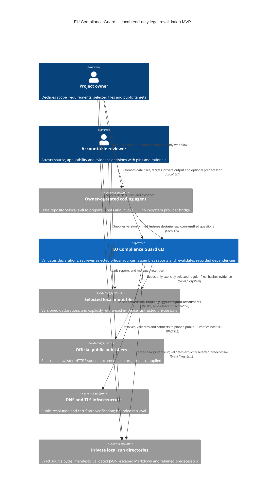

# Read-only legal revalidation MVP — system context

Status: approved by the Owner for construction against approved
[requirements](requirements.md). [Design](design.md) defines the intended CLI,
records, bounds and acceptance checks. This is planning; no operational MVP,
reviewed current-law corpus or completed legal assessment is claimed.

## System and actors

EU Compliance Guard is one local CLI unit with private files, not a running web
service. A project owner selects declarations, evidence, public official targets,
assessment date and a new output directory. A coding agent can prepare those inputs
and invoke the same CLI under repository-local skill instructions. It has no
provider bridge inside this system. Imported text never grants authority or changes
the task; the skill treats declarations, downloaded documents and tool output as
untrusted data.

The accountable reviewer records applicability, source-chain/date review and
evidence sufficiency with rationale and exact revision pins. The owner can fill
this role, but the role remains explicit. Supplied reviewer identity is a local
attestation; this CLI does not authenticate legal approval or interpret law
automatically. A reviewer or specialist must resolve unsupported jurisdiction,
national-law, translation, case-law and factual questions outside the CLI.

Official publishers provide selected public documents over HTTPS. Being an official
publisher does not make every hosted page binding, complete, applicable or current.
DNS and TLS infrastructure support retrieval; the CLI still validates every DNS
answer, pins the actual connection and verifies the original hostname certificate.
Private local storage retains inputs, source bytes and immutable report history.
The owner decides retention and deletion; Git and release packages exclude runtime
artifacts and private evidence.

## C4 context

The external storage/input boxes identify trust boundaries and local dependencies;
they are not additional deployed services. No dashboard, scanner, target
application, remediation system, model API or notification channel participates.

## Data flows and trust boundaries

| Flow | Data and responsibility | Boundary / failure behavior |
| --- | --- | --- |
| Owner/agent → CLI | Versioned `RevalidationInput`: `Scope`/`Fact`, stable declared requirements, candidate targets/obligations, family screening, reviews and selected evidence references. | Pydantic plus bounded JSON and join validation; duplicate/dangling/cross-project references fail. Imported content remains inert. |
| Selected files → CLI | Explicit regular files and expected digests; actual hashes populate `InputManifest`/`SourceFile` and `Evidence` availability. | Relative normalized paths, no-follow access, no enumeration or execution. Missing/corrupt/blocked evidence becomes a gap; malformed references fail validation. |
| CLI → official publisher | Only explicitly enabled public source GET path/query and fixed minimal headers. | Offline by default; `--fetch-official` enables selected targets only. Exact host registry, validated public DNS/IP, verified TLS, bounded per-hop redirects, no proxy/auth/cookies or project content. |
| Publisher → CLI | Exact response entity bytes plus bounded retrieval provenance; `SourceAttempt` records success/failure and `LegalSource` pins accepted content. | Size/MIME/signature/challenge checks. Uncertain identity/classification is unreviewed; failure never fabricates a source or renews old verification. |
| Reviewer → CLI through input | Pinned `SourceReview`, `ApplicabilityDecision`, `EvidenceReview`, rationale and remaining questions. | Supplied attestations do not authenticate a person or prove truth. Missing pins, date review, classification or evidence sufficiency block support. |
| CLI → private run | `AuditRun`, manifest, validated bundle, escaped Markdown, source bytes and completion marker. | New directory only, 0700/0600 modes, digests checked, marker last; incomplete output is unusable as predecessor. Evidence bodies excluded by default. |
| Prior run → successor | Explicit predecessor bundle and listed source artifacts, dependency pins and retained comparison evidence. | Verify integrity/project first; never rewrite predecessor. Relevant changes mark stale; unavailable observations mark unknown. Incomplete dependency mapping invalidates the whole assessment. |
| Report → owner/reviewer | All requirement mappings, all candidate obligation dispositions, eleven-family screening, exclusions, provenance, attestations, uncertainty and review actions. | Partial reports remain partial. No automatic legal verdict; synthetic output is visibly fictional. |

## Operational shape

The first invocation creates a report; the same command with `--previous` creates a
successor. `--output` is a new child of an owner-controlled private parent; exact
examples in [design](design.md#cli-contract-and-reproducible-workflow) create that
parent explicitly. `--offline` and `--fetch-official` are mutually exclusive;
neither flag means offline. Offline examples and tests make zero external calls.
Exit 0 means a valid retained report, possibly partial; exit 2 means no usable
report, and interrupt exits 130.

One synchronous workflow processes at most 16 source targets, one at a time, with
three redirects, 8 MiB per response, 64 MiB aggregate response bytes, five-second
socket operations, twenty-second target wall deadlines including DNS, and a
300-second network budget. One disposable standard-library retrieval helper makes
the DNS/whole-target deadline enforceable; it runs only fixed retrieval logic and
is not a target-code sandbox. Remaining targets after budget exhaustion produce
failed attempts. Other local input/collection/output bounds are in the design.

The implementation proceeds as one CLI unit through three sequential bolts:
contracts plus offline reporting; official retrieval; revalidation plus local
skill/release. Pydantic and standard-library filesystem, hashing, parsing, networking
and process primitives suffice; existing FastAPI/Uvicorn are not activated.
Contracts remain generated from `models.py` and existing commands retain meaning.

## Responsibility and limits

The CLI establishes validation, recorded provenance, traceability, safe bounded
retrieval and conservative comparison. The owner supplies scope and authorized
files; reviewers own legal interpretation, source-chain completeness,
jurisdiction/date applicability and evidence sufficiency. The candidate register
and all eleven historical legal families are screened, but missing sources or
unsupported families remain research gaps. No all-EU-law search is implied.

An unchanged source digest establishes only unchanged recorded bytes. It does not
prove the document remains legally current or renew reviewer approval. Private
artifact modes protect normal local access, while digests detect alteration;
neither prevents the account owner from changing files. Retaining metadata does
not guarantee an external evidence file will remain available.

Synthetic tests, generated-contract checks and package/example verification prove
defined software behavior only. Live retrieval is a separately opted-in smoke
check; it is not legal verification, a compliance audit or containment proof.
